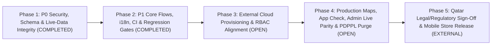

# MASHWAR Platform — Principal Engineering Implementation Roadmap

**Baseline:** `b86e8cb`  
**Current Verified State:** `851d22d` (`main`)  
**Objective:** Track all P0–P3 engineering tasks required to take MASHWAR from audited baseline (`b86e8cb`) to a hardened, production-operable Qatar platform, clearly distinguishing **Completed** engineering work from **Remaining / External** prerequisites.

---

## 1. Execution Sequence & Dependency Graph

---

## 2. Master Task Matrix & Completion Status

### Priority 0 (P0) — Production Blockers & Security Bypasses

| ID | Task | Dependencies | Verification Method | Status | Commit |
| --- | --- | --- | --- | --- | --- |
| R-01 | Fix `vercel.json` `X-Frame-Options` to allow `SAMEORIGIN` framing on `/maps/(.*)` and `/admin/maps/(.*)` + add HSTS | None | `principal_audit_regression_test.dart` + live Edge QA iframe check | **COMPLETED** | `148d4b5` |
| R-02 | Close Parcel Pickup OTP bypass & enforce Delivery OTP verification in `firestore.rules` + fail-closed `verifyDeliveryOtp()` | None | Rules review + live Firestore Emulator (10/10 PASS) | **COMPLETED** | `c227960`, `29553b8` |
| R-03 | Align `firestore.rules` `work_requests` allowed keys & timestamp/ISO validators with Cloud Functions `handlers.ts` | None | `functions` npm test (13/13) + live Emulator (10/10) | **COMPLETED** | `c227960`, `148d4b5` |
| R-04 | Fix `FirebaseAuthRepository.submitNationalId()` to emit exact `isValidProviderVerification` schema | None | `firebase_repositories_test.dart` + Emulator schema alignment | **COMPLETED** | `29553b8` |
| R-05 | Fix `AdminProvider._persistSnapshot()` to write schema-valid split docs (`platform_config/global`, `service_catalog`, `corridors`, `feature_flags`) | None | `admin_enterprise_devops_test.dart` + `firebase_admin_repository.dart` | **COMPLETED** | `29553b8` |
| R-06 | Add all 8 missing composite Firestore indexes to `firestore.indexes.json` (`work_requests`, `board_ads` x3, `rides` x2, `private`, `work_offers`) | None | JSON validation + query parity check | **COMPLETED** | `148d4b5` |
| R-07 | Fix `FirebaseRidesRepository.bookRide()` seat decrement & error propagation + `RidesProvider` `bookingId`/`.update()` fixes | None | `flutter test` (211/211 PASS) | **COMPLETED** | `29553b8` |
| R-08 | Fix inverted `enableDigitalWallet` guard in `AuthProvider` and fail-closed `FirebaseWalletRepository` ledger error handling | None | `mvp_models_and_auth_test.dart` + `flutter test` | **COMPLETED** | `29553b8` |
| R-09 | Fix `FirebaseChatRepository.sendMessage` immutable `participantIds` overwrite + add real stream subscription & error/retry UI in `ChatScreen` | None | `flutter test` + narrow-viewport overflow fix | **COMPLETED** | `29553b8`, `fc400af`, `851d22d` |
| R-10 | Eliminate all live fake consumer simulations (`BookingWaitingScreen` timer, `ReportIssueScreen` `#5127`, `ServiceEscrowScreen` any-4-digit OTP, fake driver/board/SOS lists) | None | `flutter test` + live Edge Consumer QA | **COMPLETED** | `fc400af` |
| R-11 | Fix `AppStrings.translateDate` Arabic word corruption (`ص`/`م` lookaround) & add all 12 months + Admin status map | None | `principal_audit_regression_test.dart` | **COMPLETED** | `29553b8` |
| R-12 | Replace hardcoded `http://localhost:8080/` CTA links in `landing_page/index.html` with dynamic environment resolver | None | Live Edge QA (`:8088` -> `:8080`, prod `/` & `/admin/`) | **COMPLETED** | `148d4b5` |

---

### Priority 1 (P1) — Security Hardening, Operational Parity & Release Gates

| ID | Task | Dependencies | Verification Method | Status | Commit / Owner |
| --- | --- | --- | --- | --- | --- |
| R-13 | Block `image/svg+xml` via explicit raster MIME allowlist in `storage.rules` & `MediaUploadService`; add avatar/driver/chat Storage paths | None | `principal_audit_regression_test.dart` + live Storage Emulator | **COMPLETED** | `148d4b5`, `29553b8` |
| R-14 | Add `isValidAdminAuditLog` to `firestore.rules`, standardize `createdAt`, prevent duplicate client logs, and remove dead `users_public` matcher | None | Live Firestore Emulator + `admin_enterprise_devops_test.dart` | **COMPLETED** | `c227960`, `29553b8` |
| R-15 | Persist all extended worksite fields in Cloud Functions `handlers.ts`, align `AdminRole` (`financeAdmin`/`devopsAdmin`), map `suspended -> rejected`, add `withdrawWorkOffer` callable | None | `functions` `npm run build && npm test` (13/13 PASS) | **COMPLETED** | `148d4b5`, `29553b8` |
| R-16 | Fix `FirebaseBoardRepository.getMySentOffers` IDOR, `ParcelsProvider` `MockData.activeParcel` leak & mutation persistence, and `work_offers` provider-scoped queries | R-06 | `principal_audit_regression_test.dart` + `flutter test` | **COMPLETED** | `29553b8` |
| R-17 | Wire `ParcelDisputeScreen` to real `MediaUploadService` photo upload + clear live consumer form demo prefills | R-13 | `flutter test` | **COMPLETED** | `fc400af` |
| R-18 | Harden Admin Portal: `admin_main.dart` delegates & startup failure gate, canonical filter keys, crash guards, 14-module unified RBAC matrix, zero-Arabic English KPIs, `Reset Defaults` confirmation, dark NOC mode, dispose 48 modal controllers | None | `flutter test` (211/211) + Live Edge Admin QA (0 Arabic leaks) | **COMPLETED** | `29553b8`, `fc400af`, `851d22d` |
| R-19 | Sync 3-pillar Direct Settlement copy & 14-module metadata across Consumer UI, `web/health.json`, and Landing Page SSR; remove personal Gmail / `+20` phone | None | `health.json` + Live Edge QA (Consumer, Admin, Landing) | **COMPLETED** | `148d4b5`, `fc400af` |
| R-20 | Add `test-functions` job to `.github/workflows/mashwar_ci_cd.yml` gating production web bundle builds | None | Workflow syntax & local `npm run build && npm test` | **COMPLETED** | `148d4b5` |
| R-21 | **Unify Three-Way Admin RBAC (`firestore.rules`, `storage.rules`, `functions/src/handlers.ts`)** via an atomic admin-provisioning script/callable syncing Auth Custom Claims + `admin_staff/{uid}` | Blaze Firebase project + Admin SDK | Emulator test covering Firestore + Functions + Storage under identical admin account | **OUTSTANDING** | Engineering |
| R-22 | **Deploy Firebase Backend Infrastructure** (Upgrade project to Blaze, deploy `firestore.rules`, `firestore.indexes.json`, `storage.rules`, and all 11 Cloud Functions v2 in `europe-west1`) | Billing account (Blaze) | `firebase deploy` + smoke test against live project | **EXTERNAL** | Infra / Founder |
| R-23 | **Complete Live Persistence for Remaining Non-Worksite Admin Tabs & Inline KYC Image Viewer** (driver approvals, user ban/wallet, disputes, rides/parcels moderation, staff CRUD, real `/health.json` + Firestore SRE probes, live dashboard chart aggregation) | R-21, R-22 | Live Admin portal mutation reload test | **OUTSTANDING** | Engineering |
| R-24 | **Live `+974` SIM Phone OTP Verification on Firebase Blaze** | R-22 + Qatar SIM | End-to-end physical device SMS OTP sign-in | **EXTERNAL** | QA / Operations |

---

### Priority 2 (P2) — Scale, Compliance & Operational Hardening

| ID | Task | Dependencies | Verification Method | Status | Commit / Owner |
| --- | --- | --- | --- | --- | --- |
| R-25 | Pause map 60fps `requestAnimationFrame` on `document.hidden` / `prefers-reduced-motion`, remove `Consumer2` root rebuild, fix `_TelemetryChartPainter.shouldRepaint`, add chat `StreamController` eviction | None | `flutter test` + Live Edge QA | **COMPLETED** | `148d4b5`, `29553b8`, `fc400af` |
| R-26 | Delete dead `api_client.dart`, unreachable UI widgets, and 21 unused image assets (~5.55 MB) | None | `flutter analyze` (0 issues) + Landing QA (12/12 images loaded) | **COMPLETED** | `148d4b5`, `29553b8`, `fc400af` |
| R-27 | **Replace Unofficial `mt{s}.google.com` Tiles & Public `router.project-osrm.org` Demo Server** with licensed Maps/Mapbox tiles and self-hosted or commercial OSRM/Directions proxy | Paid map/routing account or VPS | Load test + zero requests to `mt*.google.com` / `router.project-osrm.org` | **OUTSTANDING (EXTERNAL)** | Infra + Engineering |
| R-28 | **Enable Firebase App Check (`firebase_app_check` + `enforceAppCheck: true`) & Move `investor_inquiries` Behind Rate-Limited Cloud Function** (replace client `formsubmit.co`) | R-22 + reCAPTCHA Enterprise / App Attest / Play Integrity + SMTP/SendGrid | Unverified client calls rejected; rate-limit 429 verified | **OUTSTANDING (EXTERNAL)** | Security + Infra |
| R-29 | **Make `deleteUserAccount` Transactional & Complete Qatar PDPPL Data Purge** (purge `users/{uid}/private/*`, `work_offers`, `route_alerts`, `notifications`, `driver_verifications`, and Storage `provider_verifications/{uid}/*`) | R-22 | Cloud Functions unit + Emulator deletion audit | **OUTSTANDING** | Backend Engineering |
| R-30 | **Move Ride Booking/Cancellation & Board Offer Sync to Server Cloud Functions** (remove client-side multi-doc race risk) | R-22 | Concurrency test preventing overbooking | **OUTSTANDING** | Backend Engineering |
| R-31 | **Add Full Root CSP to `vercel.json`, Inject Firebase Keys via GitHub Secrets, & Run `test:rules` Emulator Suite in CI** | GitHub Secrets + Java in GH Actions | CI run green with emulator rules suite + securityheaders.com scan | **OUTSTANDING** | DevOps |
| R-32 | **Optimize Remaining Flutter Image Assets (~7.48 MB -> WebP `<150 KB`), Replace 87 Raw `fontFamily: 'Cairo'` References, Extract `IAlertsRepository`, Close Remaining `http.Client`s, & Complete `Semantics` Audit** | None | Lighthouse / bundle size diff + screen-reader pass | **OUTSTANDING** | Frontend Engineering |

---

### Priority 3 (P3) — Maintainability & Regulatory / Store Launch

| ID | Task | Dependencies | Verification Method | Status | Commit / Owner |
| --- | --- | --- | --- | --- | --- |
| R-33 | Consolidate duplicated 14-city Qatar alias matching into `lib/data/services/qatar_city_matcher.dart` | None | `principal_audit_regression_test.dart` | **COMPLETED** | `29553b8` |
| R-34 | Deduplicate `web/maps/` & `landing_page/maps/` into a single build-synced source | None | Build script check | **OUTSTANDING** | Engineering |
| R-35 | Split monolithic screens (>2,500 lines: `home_screen.dart`, `work_request_details_screen.dart`, `account_extra_screens.dart`, `main_nav_shell.dart`, `driver_rides_management_screens.dart`) into feature sub-modules | None | `flutter analyze` + `flutter test` | **OUTSTANDING** | Frontend Engineering |
| R-36 | **Qatar Regulatory Clearances & Mobile Store Releases** (MoCI Commercial Registration, MoT transport/logistics licensing, QCB non-custodial payment confirmation, Apple App Store / Google Play physical builds & signing) | Legal entity + physical iOS/Android devices | Approved store builds & compliance sign-off | **EXTERNAL** | Founder / Legal |

---

## 3. Critical Remaining Blockers Before Public Production Launch

1. **Firebase Blaze Upgrade & Deployment (`R-22`):** Without Blaze, Cloud Functions v2 (`europe-west1`) and live SMS Phone OTP cannot execute in production.
2. **Admin RBAC Alignment (`R-21`):** Must mint both Auth Custom Claims and `admin_staff/{uid}` atomically before granting operator accounts live access.
3. **Licensed Map Tiles & Production Routing (`R-27`):** `mt{s}.google.com` and `router.project-osrm.org` cannot be relied upon for public traffic.
4. **App Check & Inquiry Throttling (`R-28`):** Required to prevent Firestore quota exhaustion and spam abuse.
5. **Qatar Regulatory Sign-Off (`R-36`):** Legal prerequisite for operating inter-city mobility and commercial delivery services in Qatar.
