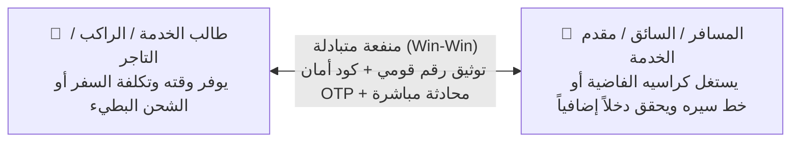

# مشوار (MASHWAR) — الدليل الشامل لفكرة المشروع ونموذج العمل والتأثير في السوق
> **وثيقة مرجعية متكاملة باللغة العربية** موجهة لأي شخص يتعرف على مشروع **«مشوار»** لأول مرة، ولإعداد عرض تقديمي احترافي (**Pitch Deck**) للمستثمرين والشركاء.

---

## 1. الملخص التنفيذي: إيه هو «مشوار» في جملة واحدة؟

**مشوار (MASHWAR)** هي **أول منصة مصرية ذكية لاقتصاد التشارك الخدمي اليومي**؛ بتجمع بين **السفر التشاركي بين المحافظات**، و**شحن الطرود والأمانات مع المسافرين**، و**لوحة مجتمعية لطلب وتنفيذ المصالح والمشتريات ونقل البضائع** — كلها في تطبيق واحد آمن وموثّق بالرقم القومي.

بدل ما السوق متقسم بين:
- تطبيقات تاكسي مكلفة داخل المدن فقط،
- مواقف وميكروباصات عشوائية بين المحافظات،
- وشركات شحن تقليدية بطيئة ومكلفة،
- وغياب تام لطريقة آمنة تخلّي حد يجيب لك ورقة أو طلب أو بضاعة من محافظة تانية...

**«مشوار» بيحول كل حركة أو سفر يومي بيحصل بالفعل في مصر لفرصة منفعة متبادلة**: شخص بيوفر وقته وفلوسه ومجهوده، وشخص تاني مسافر في نفس الطريق بيغطي مصاريفه أو يحقق دخل إضافي.

---

## 2. إحنا عايزين نعمل إيه؟ (الرؤية والرسالة)

### الرؤية (Vision)
بناء **شبكة التشارك والخدمات اليومية الأولى بين المحافظات والمراكز والقرى في مصر** (ثم التوسع إقليمياً)، بحيث تصبح أي رحلة أو مقعد فارغ أو مساحة سيارة غير مستغلة جزءاً من بنية تحتية ذكية لحركة الناس والبضائع والمصالح.

### الرسالة (Mission)
تمكين المواطن والتاجر والسائق في كل الـ 27 محافظة من تبادل المشاوير والخدمات والأمانات بطريقة **سهلة، عادلة السعر، سريعة، ومحمية تقنياً وقانونياً** — حتى في الأماكن والقرى والمراكز التي لا تصلها خدمات النقل الذكي أو الشحن السريع التقليدي.

---

## 3. بنحل مشكلة إيه؟ (المشاكل الحقيقية في السوق المصري)

السوق المصري فيه **5 مشاكل يومية ضخمة ومترابطة** مفيش منصة واحدة جمعت حلها مع بعض:

### المشكلة 1: أزمة السفر والمواصلات بين المحافظات والقرى
- **من جهة الراكب:** معاناة في المواقف، عدم انتظام المواعيد، استغلال في الأجرة أوقات الذروة، قلة الراحة والأمان في المواصلات العشوائية، وصعوبة وجود خيارات محترمة ومناسبة للبنات والسيدات أو الطلاب والموظفين المسافرين بانتظام.
- **في القرى والأرياف والمناطق البعيدة:** المواصلات العامة أحياناً منعدمة أو منقطعة في أوقات متأخرة، وتطبيقات النقل الحضري المعروفة لا تغطي التنقل بين المحافظات أو القرى اقتصادياً.

### المشكلة 2: الكراسي الفاضية وارتفاع تكاليف التشغيل على أصحاب السيارات
- آلاف السيارات الخاصة بتسافر يومياً بين المحافظات (كفر الشيخ ↔ القاهرة، طنطا ↔ الإسكندرية، المنصورة ↔ القاهرة، محافظات الصعيد والدلتا...) وهي شايلة **السائق لوحده و3 مقاعد فاضية**!
- مع ارتفاع أسعار البنزين والكارتة والصيانة، صاحب العربية بيتحمل التكلفة كلها لوحده رغم إن في ناس جنبه واقفة في الموقف محتاجة نفس المشوار ومستعدة تدفع أجرة عادلة.

### المشكلة 3: بطء وتكلفة شحن الطرود والمستندات بين المدن
- لو شخص في محافظة محتاج يبعت ورق رسمي، أمانة، دواء، أو قطعة غيار صغيرة لشخص في محافظة تانية في نفس اليوم، شركات الشحن التقليدية غالباً:
  - بتاخد من **24 إلى 72 ساعة** على الأقل (فرز ومخازن ومناديب)،
  - مكلفة جداً مقارنة بقيمة أو حجم الطرد الصغير،
  - ومحدودة في تغطية المراكز والقرى.

### المشكلة 4: إهدار يوم عمل كامل لقضاء مصلحة أو شراء طلب من مكان بعيد
- مواطن في كفر الشيخ أو بلطيم أو أسوان محتاج شهادة من جامعة في القاهرة، أو تصديق ورقة من وزارة، أو تاجر محتاج 5 كراتين مستلزمات أو فلتر معين من العتبة أو التوفيقية.
- في الواقع الحالي لازم **يسافر بنفسه يوم كامل رايح جاي** ويدفع مواصلات وأكل ويضيع شغله؛ بينما في عشرات الأشخاص الموجودين بالفعل هناك وراجعين بلده في نفس اليوم!

### المشكلة 5: انعدام الثقة والأمان عند التعامل بين الأفراد (P2P Trust Gap)
- ناس كتير بتحاول ترتب مشاوير أو أمانات بشكل بدائي في جروبات فيسبوك/واتساب، وده بينتج عنه مخاطر حقيقية:
  - حسابات وهمية ومفيش تحقق من الهوية،
  - مفيش إثبات رقمي إن الطرد اتسلم لصاحبه،
  - أرقام الموبايلات بتتكشف للعامة،
  - مفيش تتبع حي ولا مرجعية قانونية أو جهة تفض النزاعات لو حصل خلاف.

---

## 4. الحل اللي بيقدمه «مشوار» (4 ركائز في تطبيق واحد — Super App)

تطبيق **مشوار** بيقدّم تجربة موحدة تجمع كل الحلول في مكان واحد سهل وسريع:

### 1) السفر التشاركي بين المحافظات (Inter-City Carpooling)
- **البحث والمطابقة الذكية:** الراكب يختار مدينة الانطلاق والوصول والموعد، والنظام يطابق الرحلات القريبة من خط السير (بنطاق مطابقة مضبوط في إعدادات المنصة يصل افتراضياً إلى **3,000 متر**).
- **مرونة ووضوح كامل:** عرض السعر بالكرسي، نوع السيارة، عدد المقاعد المتاحة، تقييم السائق، نقاط الركوب والنزول على الخريطة، وميزة **"رحلات السيدات فقط"** (تتطلب سائقة موثقة وتُخصص للراكبات فقط بعد تأكيد النوع من بطاقة الرقم القومي).
- **تسعير متوازن:** سعر استرشادي محسوب لتكلفة الوقود مع هامش مرونة (±25%) لمنع الاستغلال أو المضاربة، وإما **حجز فوري** أو بطلب موافقة السائق (بمهلة رد محددة افتراضياً بـ **30 دقيقة**).

### 2) شحن الطرود والأمانات مع المسافرين (Crowd-Shipping Parcels)
- أي سائق/مسافر يقدر يفعّل استقبال الطرود في رحلته مع تحديد أسعار واضحة حسب الحجم (صغير / متوسط / كبير) وبحد أقصى للوزن (افتراضياً **15 كجم** في صندوق السيارة) وقيمة مصرّح بها مغطاة بنظام النزاعات والتعويض (حتى **2,000 ج.م** في إعدادات المنصة).
- **توصيل في نفس اليوم (Same-Day):** الطرد بيتحرك مع المسافر من مدخل المحافظة/نقطة الالتقاء لنقطة التسليم مباشرة بدون مخازن وسيطة.
- **حماية بقائمة المحظورات وكود OTP:** شاشة واضحة للمواد الممنوعة، وصورة إثبات، وكود استلام/تسليم سري لا تُغلق الشحنة إلا بإدخاله ومطابقته.

### 3) اللوحة المجتمعية بنظام المبادلة ثنائي الاتجاه (Dual-Intent Community Board)
دي **الضربة المميزة لمشوار** اللي بتخليه أوسع من أي تطبيق سفريات:
- أي مستخدم يقدر يبدّل بضغطة واحدة بين وضعين:
  - **«أنا أطلب خدمة / مشوار»**: عايز حد يوصلني، أو يشتري لي حاجة، أو يخلص لي ورقة، أو ينقل لي بضاعة.
  - **«أنا مسافر / أقدم خدمة»**: رايح مشوار أو مسافر بعربيتي ومستعد أخدم في طريقي.
- وتغطي اللوحة **4 تصنيفات عملية**:
  1. **سفر تشاركي وانتقالات** (بما في ذلك المناطق والقرى التي تفتقر لمواصلات منتظمة).
  2. **شراء طلبات ومستلزمات** (قطع غيار، أدوية، منتجات من مكان محدد).
  3. **قضاء مصالح وأوراق رسمية** (جامعات، مصالح حكومية، تسليم/استلام مستندات).
  4. **لوجستيات وتوريد بضائع للمحلات** (نقل سريع للتجار والورش).
- يتلقى صاحب الإعلان **عروضاً متعددة** من المسافرين ومقدمي الخدمة، ويقدر يقارن السعر والتقييم ويتواصل معهم عبر المحادثة المباشرة، ثم يختار العرض الأنسب.

### 4) منظومة الأمان، التواصل المباشر، والتنبيهات الذكية
- **التحقق بالهوية المصرية (KYC):** الرقم القومي (14 رقم مع استخراج/مطابقة تاريخ الميلاد والمحافظة) + صور البطاقة والسيلفي + رخصة القيادة ورخصة السيارة للسائقين قبل التفعيل.
- **التواصل المباشر السلس:** محادثة داخلية فورية من داخل أي إعلان أو رحلة أو طلب مع مشاركة الموقع بنقرة واحدة، وحماية خصوصية الأرقام، وردود سريعة جاهزة.
- **مركز السلامة والطوارئ (SOS Hub):** مشاركة خط السير المباشر مع العائلة (جهات طوارئ موثقة تصل إلى 3 جهات) والاتصال السريع بالطوارئ (النجدة 122 / الإسعاف 123) وإدارة حالات ضعف الإشارة.
- **تنبيهات المسارات (Route Alerts):** لو المستخدم لم يجد رحلة الآن، يضغط "تفعيل تنبيه للمسار" ليصله إشعار فوري بمجرد نشر رحلة مطابقة.

---

## 5. الفئة المستهدفة وحجم الفرصة في السوق المصري

يستهدف **مشوار** شرائح واسعة جداً تتقاطع يومياً على طرق مصر:

| الفئة المستهدفة | حجم الاحتياج الفعلي وطريقة الاستخدام |
| :--- | :--- |
| **طلاب الجامعات والمغتربون** | سفر أسبوعي متكرر بين المحافظات والقاهرة/الإسكندرية/عواصم الأقاليم + استلام أمانات ومستلزمات من الأهل في نفس اليوم. |
| **الموظفون ورجال الأعمال والمسافرون دورياً** | سفر مريح بمواعيد مضبوطة مقارنة بالمواقف، أو تقليل فاتورة بنزينهم الشهرية عند قيادة سياراتهم بمشاركة المقاعد. |
| **أصحاب المحلات التجارية والورش والشركات الصغيرة (SMEs)** | توريد بضائع وقطع غيار ومستلزمات عاجلة من أسواق الجملة (مثل العتبة والتوفيقية وغيرها) إلى المحافظات والمراكز في نفس اليوم. |
| **السيدات والعائلات** | خيار سفر آمن ("سيدات فقط" بسائقة موثقة بالرقم القومي)، وميزة تتبع الرحلة الحي مع الأسرة، وإرسال الأمانات الشخصية بأمان. |
| **سكان المراكز والقرى والأرياف** | تغطية الاحتياج اليومي للمشاوير والمصالح والطلبات في المناطق التي تفتقد لتطبيقات النقل الحديثة أو خدمات الشحن السريع. |

---

## 6. هنأثر إزاي في السوق؟ (القيمة والأثر الاقتصادي والاجتماعي والبيئي)

دخول **مشوار** وانتشاره بيخلق أثر ملموس على 4 مستويات:

1. **الأثر الاقتصادي على الأسرة والتاجر:**
   - **لأصحاب السيارات:** استغلال الطاقة المهدرة للمقاعد الفارغة يغطي نسبة كبيرة من تكاليف البنزين والكارتة والصيانة الشهرية ويحول السفر الروتيني لدخل إضافي.
   - **للركاب والتجار:** خفض تكلفة الانتقال مقارنة بالتاكسي أو العربية المخصوص، وتوفير تكاليف شحن وإهدار وقت توقف المبيعات في المحلات بفضل النقل في نفس اليوم.
2. **ثورة في سرعة قضاء المصالح واللوجستيات الخفيفة (Micro-Logistics):**
   - اختصار زمن وصول المستندات والطرود من **أيام** إلى **بضع ساعات** فقط (زمن الرحلة الفعلي بين المحافظتين)، وتوفير آلاف ساعات العمل الضائعة في السفر من أجل ورقة أو توقيع.
3. **الدمج الاقتصادي للمراكز والقرى:**
   - ربط القرى والمراكز البعيدة بحركة التجارة والخدمات في عواصم المحافظات والقاهرة دون اشتراط وجود مستودعات أو أسطول سيارات مملوك للشركة (**Asset-Light Model** = تكلفة توسع منخفضة جداً وقدرة انتشار أسرع على مستوى الجمهورية).
4. **الأثر البيئي والمروري:**
   - رفع متوسط إشغال السيارة الخاصة على الطرق السريعة، وتقليل الازدحام المروري واستهلاك الوقود والانبعاثات الكربونية لكل راكب/طرد منقول.

---

## 7. هنكسب إزاي؟ (نموذج العمل ومصادر الإيرادات — Business Model)

تعتمد منصة **مشوار** على نموذج عمل **خفيف الأصول عالي الربحية (Asset-Light Marketplace)**؛ المنصة لا تشتري سيارات ولا تدفع مرتبات سائقين ولا تتحمل صيانة أسطول أو إيجار مخازن، وإنما تحقق إيراداتها من ربط العرض بالطلب وضمان الأمان:

### مصادر الإيرادات الأساسية (Built into Architecture)
1. **عمولة ديناميكية على كل معاملة مكتملة (Dynamic Category Commission):**
   - تحصل المنصة على نسبة عمولة مئوية من قيمة كل عملية ناجحة (حجز مقعد، شحن طرد، أو تنفيذ طلب خدمة على اللوحة).
   - **ميزة ذكية مبنية في تصميم النظام:** النسبة **مرنة وديناميكية حسب فئة الخدمة** وتُضبط مركزياً من لوحة الإدارة؛ مثلاً يمكن أن تكون نسبة عمولة الركاب أقل لتشجيع السيولة والانتشار، ونسبة عمولة شحن الطرود أو لوجستيات التجار أعلى لأن قيمتها المضافة وسرعتها أعلى للعميل.
2. **إدارة المدفوعات والمحفظة والتسويات الرقمية (Wallet & Payment Ledger):**
   - يدعم التطبيق **الدفع النقدي المباشر** (لتسهيل التبني الفوري من الجمهور المصري غير المعتاد على الكروت)، بالتوازي مع **المحفظة الإلكترونية** والشحن/السحب عبر القنوات الأكثر انتشاراً في مصر مثل **إنستاباي (InstaPay)** و**فودافون كاش (Vodafone Cash)** مع رفع صور الإيصالات والتحقق منها.
   - جميع القيود المالية في قاعدة البيانات محسوبة بأعداد صحيحة بعملة **القرش (Integer Piastres)** لضمان دقة محاسبية 100% ومنع أي تلاعب أو أخطاء كسور.

### آفاق التوسع في الإيرادات (Future Growth Revenue Streams)
- **باقات التجار والشركات (B2B Logistics Subscriptions):** اشتراكات شهرية مخفضة لأصحاب المحلات والمكاتب دائمي إرسال الطرود والطلبات مع أولوية مطابقة على اللوحة.
- **حماية وتأمين إضافي للشحنات القيّمة:** رسوم حماية اختيارية على الطرود ذات القيمة العالية تتجاوز حد التغطية الأساسي.
- **ترويج الإعلانات والطلبات المستعجلة (Boosted Board Requests):** دفع رسوم رمزية لإبراز طلب مستعجل أو رحلة في أعلى نتائج البحث والتنبيهات.

### ليه اقتصاديات الوحدة (Unit Economics) قوية في «مشوار»؟
- **صفر تكاليف أصول (Zero Fleet CapEx):** السائقون يتحركون بالفعل في رحلاتهم الخاصة أو بين المحافظات.
- **تكلفة استحواذ منخفضة (Low CAC) وتأثير الشبكة الفيروسي (Network Effects):** كل تاجر بيستخدم «مشوار» عشان يبعت طرد بيجيب معاه مسافرين، وكل سائق بياخد طرود أو ركاب بيدعو معارفه، وكمان العميل الواحد بيستخدم التطبيق في **أكثر من غرض** (مرة راكب، مرة مرسل طرد، ومرة طالب خدمة)، فترتفع قيمة العميل الدائمة (**LTV**) وتقل حاجتنا لصرف إعلانات متكررة لكل خدمة.

---

## 8. ليه «مشوار» مختلف عن المنافسين؟ (الميزة التنافسية)

| وجه المقارنة | **مشوار (MASHWAR)** | تطبيقات التوصيل الحضري (أوبر/كريم/إن درايف) | المواصلات والميكروباص التقليدي | شركات الشحن التقليدية (بوسطة/أرامكس...) |
| :--- | :--- | :--- | :--- | :--- |
| **التغطية بين المحافظات والقرى** | **نعم (الـ 27 محافظة + المراكز والقرى)** | غالباً داخل المدن؛ بين المحافظات مكلف جداً | محدودة بخطوط ومواقف رئيسية فقط | مراكز التغطية في القرى أبطأ وأعلى تكلفة |
| **تكلفة المشوار** | **تشاركية منخفضة** (تقاسم بنزين وكراسي فاضية) | تكلفة رحلة كاملة على راكب واحد | رخيصة لكن مزدحمة وبلا ضمان راحة | غير متاح لنقل الأفراد |
| **سرعة شحن الطرد/الورق** | **نفس اليوم (ساعات فقط)** مباشرة مع المسافر | غير مخصصة للشحن بين المحافظات | غير مضمونة وبلا توثيق أو تعويض | **من 24 إلى 72 ساعة** |
| **قضاء مصالح وشراء طلبات بين المدن** | **نعم (لوحة مجتمعية ثنائية الاتجاه)** | غير متاحة بين المحافظات | غير متاح | غير متاح |
| **الأمان والتوثيق** | **رقم قومي + كود OTP + SOS + تتبع + سيدات فقط** | تتبع داخل الرحلة لكن بدون لوحة مصالح أو OTP طرود | **معدوم** | تتبع طرود فقط بلا تفاعل مرن |

---

## 9. الوضع الحالي والجاهزية التقنية للمشروع (Product & Tech Readiness)

المشروع ليس مجرد فكرة على ورق — **النموذج التشغيلي والبنية البرمجية مبنية ومختبرة بالفعل**:

### 1) واجهات التطبيق وتجربة المستخدم (Consumer App — 45+ ملف شاشة)
- مبني بإطار **Flutter / Dart** ليعمل بكفاءة عالية على **Android و iOS و Flutter Web** (يعمل مباشرة كنسخة ويب حية للتجربة والعرض).
- **تصميم Super-App احترافي** مستوحى من أوبر وكريم مع الحفاظ الكامل على الهوية البصرية لمشوار، أنميشن ناعم، خرائط ومسارات رحلات (`MashwarRouteTimeline`)، شريط تواصل بضغطة واحدة، وتجربة ثنائية اللغة بالكامل (**العربية RTL والإنجليزية LTR**).
- دعم كامل لكل الرحلات: التسجيل وتوثيق البطاقة، الصفحة الرئيسية، اللوحة المجتمعية، تقديم العروض، البحث والفلاتر، تفاصيل الرحلة، الحجز والانتظار، الرحلة الجارية، الشحن وكود OTP والنزاعات، المحفظة، الأمان والطوارئ، حساب السائق وإدارة المركبة والرحلات.

### 2) لوحة تحكم إدارة متكاملة للويب (Admin Web Control Panel — `admin_main.dart`)
- منظومة إدارة مستقلة للمشغلين وفريق العمل مع **تحكم في الصلاحيات حسب الدور** (`Super Admin` / `Review Admin` / `Support Admin`):
  - **لوحة مؤشرات الأداء (KPIs Dashboard):** متابعة المستخدمين الجدد، الرحلات المنشورة، الحجوزات المؤكدة، نسبة التحويل، والطرود المسلمة عبر فترات زمنية (اليوم / 7 أيام / 30 يوماً).
  - **إدارة توثيق السائقين (KYC):** مراجعة البطاقات والرخص والسيارات والموافقة أو الرفض مع توثيق السبب.
  - **إدارة المستخدمين والرحلات والطرود:** مراقبة الرحلات الحية، التدخل اليدوي وتعديل الحالات، وإدارة الإيقاف والحظر بالضوابط.
  - **حسم النزاعات والبلاغات:** خط زمني لكل بلاغ وتعيين المشرف وحل النزاع وتعويض المتضرر.
  - **إعدادات النظام الحية وسجل التدقيق (Audit Trail):** تعديل نطاق المطابقة، مهلة رد السائق، هامش السعر، حد وزن وقيمة الطرد، ونافذة الإلغاء المجاني — مع تسجيل تلقائي لكل إجراء إداري للمحاسبة والشفافية.

### 3) البنية التحتية للبيانات والأمان (Backend Architecture & QA)
- **Clean Layered Architecture:** فصل كامل للواجهات عن قواعد البيانات عبر طبقة `Repositories & Contracts` ومزودات الحالة (`Provider`).
- **التكامل السحابي والأمان:** تهيئة كاملة لربط **Firebase** (`firebase_core`, `firebase_auth`, `cloud_firestore`) وقواعد أمان مكتوبة في `firestore.rules` (1,098 سطراً)، إلى جانب توثيق البنية والـ API وقاعدة البيانات في مجلد `docs/backend/`.
- **الجودة والاختبارات:**
  - فحص الكود الساكن (`flutter analyze`): **0 أخطاء و0 تحذيرات**.
  - اختبارات آلية (`flutter test`): **71/71 اختباراً ناجحاً** تغطي تطبيق العميل، لوحة التحكم الإدارية، تدفقات الأمان، اللغة، والتجاوب مع كل مقاسات الشاشات.

---

## 10. خارطة الطريق للتنفيذ والإطلاق (Roadmap)

### المرحلة الأولى: الإطلاق التجريبي المركّز (MVP & Corridor Launch)
- تفعيل الربط السحابي الكامل على بيئة الإنتاج (`Firebase Auth`, `Firestore`, `Google Maps API` المفعل بالمفاتيح الإنتاجية وبوابة الرسائل SMS OTP عند الإتاحة).
- التركيز على **خط سير تجريبي عالي الكثافة** (مثل خط **كفر الشيخ / طنطا ↔ القاهرة / الإسكندرية**) لتكوين سيولة فورية من السائقين والطلاب والتجار بدلاً من تشتيت التسويق في كل المحافظات مرة واحدة.
- تشغيل فريق مراجعة البطاقات ورخص القيادة (الـ 24 ساعة التزاماً بالأمان) وإطلاق برامج حوافز لأوائل السائقين الموثقين.

### المرحلة الثانية: التوسع الجغرافي وتعميق السيولة (Scale & Density)
- التوسع إلى كل محافظات الدلتا والقناة ثم محافظات الصعيد (27 محافظة).
- إطلاق الشراكات المباشرة مع أسواق الجملة، المحلات التجارية، والمكاتب الإدارية لاستخدام اللوحة المجتمعية وشحن الطرود يومياً.
- أتمتة التسويات الرقمية عبر بوابات الدفع المحلية و**InstaPay** وإطلاق ميزات التقييم المتقدم والإكراميات والتأمين الاختياري على الشحنات.

### المرحلة الثالثة: التكامل الذكي والنمو الإقليمي (Automation & Regional Growth)
- خوارزميات مطابقة واقتراح ذكية للمسارات متعددة التوقفات (Multi-stop Corridor Matching).
- خدمات **مشوار بزنس (Mashwar B2B)** للشركات والمتاجر الإلكترونية للشحن بين المحافظات في نفس اليوم.
- نقل النموذج إلى أسواق إقليمية مشابهة في الكثافة السكانية والاعتماد على الاقتصاد التشاركي.

---

## 11. ملحق جاهز: تقسيم مقترح لشرائح العرض التقديمي (12-Slide Pitch Deck Outline)

يمكن لصاحبك استخدام هذا الترتيب لبناء الـ **Pitch Deck** مباشرة:

1. **الشريحة 1 — الغلاف (Cover):** شعار **مشوار (MASHWAR)** + سطر الهوية: *"رحلتك، طردك، ومصلحتك في نفس الطريق — أول منصة مصرية متكاملة لاقتصاد التشارك الخدمي اليومي"*.
2. **الشريحة 2 — المشكلة (The Problem):** أرقام وواقع أزمة المواصلات بين المحافظات والقرى + كراسي السيارات الفارغة + بطء وغلاء الشحن التقليدي + ضياع أيام العمل لقضاء المصالح + غياب الأمان في الجروبات العشوائية.
3. **الشريحة 3 — الحل (The Solution):** منصة واحدة 4×1 (سفر تشاركي + شحن طرود نفس اليوم + لوحة مصالح وبضائع ثنائية الاتجاه + توثيق وأمان متكامل).
4. **الشريحة 4 — كيف يعمل مشوار؟ (How It Works):** 3 خطوات بسيطة مع سيناريوهين حقيقيين (مواطن يخلص ورقة أو تاجر ينقل بضاعة + مسافر يغطي بنزينه بركاب وطرود).
5. **الشريحة 5 — استعراض المنتج (Product Showcase):** لقطات من التطبيق الحالي (الرئيسية، اللوحة المجتمعية، المحادثة الفورية، وتتبع الطرد بكود OTP) + لوحة الإدارة.
6. **الشريحة 6 — لماذا الآن وحجم الفرصة (Market Opportunity & Why Now):** ارتفاع تكاليف المعيشة والوقود يدفع الجميع لتعظيم الدخل وتقليل المصاريف + انتشار الهواتف والمحافظ الإلكترونية (InstaPay / Vodafone Cash) + فجوة القرى والمحافظات.
7. **الشريحة 7 — الميزة التنافسية (Why MASHWAR Wins):** جدول المقارنة ضد أوبر/كريم، الميكروباص، وشركات الشحن — مع التركيز على ميزة **Dual-Intent Board** ومنظومة الثقة.
8. **الشريحة 8 — منظومة الثقة والأمان (Trust & Legal Moat):** الرقم القومي + فحص الرخص + كود `OTP` + الدردشة المشفرة + `SOS` + رحلات "سيدات فقط" الموثقة بالهوية.
9. **الشريحة 9 — نموذج الربح (Business Model):** Asset-Light Marketplace + عمولات ديناميكية حسب فئة الخدمة + تسويات المحفظة + فرص B2B وترويج الطلبات.
10. **الشريحة 10 — استراتيجية الانطلاق (Go-To-Market Strategy):** استراتيجية الممرات عالية الكثافة (Corridor-by-Corridor؛ مثل الدلتا ↔ القاهرة)، الجامعات، وتجار أسواق الجملة.
11. **الشريحة 11 — الجاهزية التقنية وما تم إنجازه (Traction & Execution Readiness):** منتج فعلي مبني بالكامل (45+ شاشة للمستخدم + لوحة إدارة + معمارية سحابية Firebase + قواعد أمان + 71 اختباراً ناجحاً).
12. **الشريحة 12 — الرؤية والطلب (Roadmap & The Ask):** ماذا نحتاج للمرحلة القادمة (تشغيل الإنتاج والـ APIs المدفوعة، استكمال التراخيص والتسويق الإطلاقي للممر الأول، وتوسيع الفريق) والعائد المتوقع.
