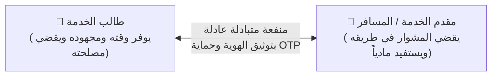

# مشوار (MASHWAR) — المنصة الذكية لتبادل وقضاء المشاوير والمصالح اليومية

<p align="center">
  
  
  
  
  
  
  
</p>

<p align="center">
  <b>"خدمتك ومشوارك في نفس الطريق — منفعة متبادلة، أمان موثّق بالرقم القومي، وتوفير للوقت والجهد"</b><br/>
  <i>أول منصة مصرية خدمية وتشاركية مفتوحة لقضاء كافة المشاوير والمصالح اليومية ونقل البضائع والأمانات والسفر التشاركي</i>
</p>

---

## 💡 الفكرة والجوهر: اقتصاد التشارك الخدمي اليومي (The Core Philosophy)

تطبيق **مشوار (MASHWAR)** ليس مجرد تطبيق سفريات أو طرود، بل هو **منصة خدمية متكاملة لتبادل وقضاء المشاوير والمصالح اليومية** لجميع فئات المواطنين والتجار والمسافرين في كل محافظات ومراكز وقرى مصر.

تقوم فكرة المنصة على معادلة ذكية وبسيطة من **المنفعة المتبادلة (Win-Win Model)**:
- **طرف يحتاج خدمة أو مشوار (طالب الخدمة):** يوفر على نفسه عناء السفر، ضياع يوم عمل كامل، مشقة الانتظار في المواصلات، أو تعطل مصالحه. ينزل إعلاناً بطلبه والمقابل المادي المقترح.
- **طرف قادر على تنفيذ الخدمة (مقدم الخدمة / المسافر):** يستغل تحركه، سفره بسيارته، أو مساره اليومي ليقضي مصلحة لأخيه المواطن ويحقق دخلاً إضافياً ومقابلاً مادياً عادلاً.



---

## 🌍 سيناريوهات وأمثلة حية من واقع الحياة اليومية (Real-World Use Cases)

تغطي المنصة مختلف المشاوير والخدمات التي يحتاجها المواطن يومياً بكل مرونة، ومنها على سبيل المثال:

### 1. 🛍️ الشراء وتوصيل الاحتياجات (Buying & Everyday Errands)
- **الموقف:** شخص في بيته، أو تاجر في محله، ومحتاج حد يشتري له مستلزمات معينة، أدوية ضرورية، طلبات خاصة، أو بضاعة عاجلة من مكان بعيد داخل مدينته أو من مركز مجاور.
- **الحل عبر مشوار:** ينزل إعلاناً: *"أنا في المكان الفلاني ومحتاج حد يشتري لي كذا وكذا من المكان الفلاني ويجيبه في الوقت كذا"* -> يتلقى عروضاً من أشخاص قريبين، ينفذ أحدهم المشوار ويوصل الطلب ويحاسبه بمقابل مادي.

### 2. 📄 قضاء المصالح وجلب الأوراق بين المحافظات (Cross-Governorate Services)
- **الموقف:** مواطن مقيم في **كفر الشيخ** أو **بلطيم** أو **الإسكندرية** أو **الصعيد**، ومحتاج ورقة رسمية من وزارة أو جهة معينة بالقاهرة، أو محتاج استلام مستند عاجل من هناك.
- **الحل عبر مشوار:** بدل أن يسافر للقاهرة يوماً كاملاً ويتحمل مصاريف وتعب وتضييع يوم شغل، ينزل إعلاناً على التطبيق -> أي شخص متواجد بالقاهرة ومسافر في طريقه إلى كفر الشيخ أو بلطيم يتواصل معه، يجلب له الورقة أو المستند بأمان ويسلمه له عند وصوله ويستلم مقابله المادي المتفق عليه.

### 3. 🚗 السفر التشاركي عند أزمة المواصلات (Shared Travel & Empty Seats)
- **من منظور الراكب:** مسافر من كفر الشيخ إلى القاهرة ومفيش عربيات متوفرة في الموقف أو المواصلات مقطوعة ومزدحمة -> يفتح التطبيق ويشوف مين من أهل بلده مسافر بعربيته الخاصة في نفس التوقيت ومعاه كراسي فاضية ويحجز ويسافر معاه باحترام وراحة.
- **من منظور صاحب السيارة:** شخص مسافر بسيارته من محافظة لمحافظة وعنده 3 مقاعد شاغرة -> ينزل إعلاناً بالموعد وسعر الكرسي، يحجز معه مسافرون في نفس الاتجاه -> يتقاسم معهم تكلفة البنزين والكارتة ويحقق عائداً يغطي مصاريف سفره، ويفيد ركاباً محتاجين مواصلة مريحة.

### 4. 📦 لوجستيات وتوريد البضائع للمحلات (Shop Cargo & Supplies)
- **الموقف:** صاحب محل أو ورشة محتاج كرتونة بضاعة أو قطع غيار أو خامات عاجلة من مورد في القاهرة أو طنطا أو الإسكندرية.
- **الحل عبر مشوار:** يطلب عبر التطبيق نقل وتوريد البضاعة لموقعه مباشرة، ويستلمها في نفس اليوم مع مسافر موثوق بسرعة أكبر وأوفر بكثير من شركات الشحن التقليدية.

### 5. 📍 المشاوير والانتقالات المحلية المباشرة (On-Demand Local Transport)
- **الموقف:** مواطن في منطقة ريفية، قرية، عزبة، أو طريق فرعي لا تتوفر فيه مواصلات عامة أو غير متاح توكتوك في ذلك التوقيت.
- **الحل عبر مشوار:** ينزل طلباً بموقعه ووجهته، يتوجه إليه أقرب سائق أو شخص متاح يقضي له مشواره ويوصله بأمان بمقابل عادل.

> **💡 القاعدة العامة:** المنصة غير مقتصرة على خدمة واحدة؛ **أي خدمة، أي مشوار، أو أي مصلحة يومية بين طرفين** يمكن الاتفاق عليها وإنجازها عبر مشوار بكل سلاسة وأمان.

---

## 🛡️ منظومة الأمان والتوثيق وحفظ حقوق الطرفين (Trust & Security)

لأن المنصة تتعامل مع مصالح وخدمات وأمانات حقيقية، تم بناء بيئة أمان متكاملة تحمي حق المواطن والمسافر على حد سواء:

| ركيزة الأمان | آلية العمل والضمان |
| :--- | :--- |
| **🪪 توثيق البطاقة الشخصية (National ID)** | رفع ومراجعة بطاقة الرقم القومي ورقم الهاتف للطرفين قبل تنفيذ المعاملات، لضمان الهوية والمساءلة القانونية التامة. |
| **🔢 كود التسليم الرقمي الآمن (4-Digit OTP)** | لا يتم تسليم أي ورقة رسمية، بضاعة، أو أمانة، ولا تُعتبر الخدمة منتهية إلا بعد مطابقة كود OTP السري بين المسلّم والمستلم. |
| **🔒 دردشة مشفرة وخصوصية تامة** | نظام مراسلة داخلي مشفر يحفظ خصوصية أرقام الهواتف الشخصية من الظهور للعامة. |
| **🚨 مركز السلامة وزر الطوارئ (SOS Hub)** | إمكانية مشاركة خط السير الحي مع العائلة بنقرة واحدة والاتصال الفوري بجهات الطوارئ. |
| **⭐ تقييمات وسمعة حقيقية** | تقييم متبادل بعد كل خدمة يعكس مصداقية الطرفين ويشجع على التعامل الراقي. |

---

## 📱 مميزات التطبيق وتجربة الاستخدام (Key App Features)

### 📢 اللوحة المجتمعية بنظام المبادلة الذكية (Dual-Intent Community Board)
- **أنا أطلب خدمة / مشوار:** مخصص لمن يحتاج قضاء مصلحة، شراء طلب، نقل بضاعة، حجز مقعد، أو مشوار محلي.
- **أنا مسافر / أقدم خدمة:** مخصص لمن يسافر ولديه سيارة أو مقاعد خالية، أو مستعد لتقديم خدمة وتوصيل طلب في طريقه.
- **بطاقة خط السير المتصلة العصرية (Connected Route Card):** تصميم انسيابي وأنيق لحقول الانطلاق والوصول، زر تبديل فوري (`⇅`)، وقائمة سريعة تغطي كافة محافظات ومراكز مصر الـ 27.

### 🎨 واجهة مستخدم إنتربرايز نقية (Uber-Style Minimalist UI)
- أسطح بيضاء نقية (`#FFFFFF`) وظلال هادئة وخلو تام من البهرجة أو الإيموجي المشتتة.
- تم حذف كافة الأشرطة واللافتات المكررة لتبدأ كل شاشة مباشرة بوظيفتها الأساسية وتسهل الاستخدام على كل الفئات العمرية.

### 📐 تصميم متجاوب لجميع الشاشات (Full Responsive Multi-Viewport)
- يعمل بسلاسة كاملة على كافة أحجام الشاشات:
  - الهواتف الذكية الضيقة والعادية (320px إلى 414px).
  - الأجهزة اللوحية (Tablets 768px).
  - شاشات الويب والكمبيوتر الكبيرة (1280px وما فوق).
- شاشات تسجيل دخول وترحيب موحدة في منتصف الشاشة بدون تشوهات عرض.

### ⚙️ إعدادات ذكية ومركز إشعارات متطور (Settings & Notifications Hub)
- التحكم الكامل في إشعارات الرحلات والطرود وعروض اللوحة القريبة في نطاق 50 كم.
- قسم مدمج لإدارة **تنبيهاتي للمسارات المتابعة (My Route Alerts)** مع عداد ذكي بالتنبيهات المفعلة.

---

## 🏗️ الهيكلية المعمارية للمشروع (Architecture & Codebase)

تم بناء المشروع وفق مبادئ **Clean Layered Architecture** مع فصل تام بين طبقات العرض والمنطق والبيانات:

```text
lib/
├── core/                  # Design Tokens, AppTheme, Typography, Dimens, Global Widgets
│   ├── constants/         # AppColors, AppTypography, AppDimens
│   ├── localization/      # AppStrings, Translation Helpers (AR / EN)
│   ├── theme/             # Light AppTheme (Cairo Font, Minimal Enterprise)
│   └── widgets/           # MashwarButton, MashwarTextField, MashwarBadge, RouteMapView
├── data/                  # Models & Mock Repositories
│   ├── models/            # UserModel, RideModel, ParcelModel, BoardAdModel, RouteAlertModel
│   └── mock_data.dart     # Comprehensive Egyptian Scenarios (27 Governorates)
├── state/                 # State Management (MultiProvider)
│   ├── auth_provider.dart       # User Session, National ID Verification & Login State
│   ├── rides_provider.dart      # Ride Booking, Seat Management & Pricing
│   ├── parcels_provider.dart    # Parcel Transits & OTP Lifecycle
│   ├── board_provider.dart      # Community Ads, Offer Negotiation & Intent Filtering
│   ├── alerts_provider.dart     # Route Alerts & Notification Toggles
│   ├── settings_provider.dart   # Language (RTL/LTR) & Push Preference Controls
│   └── admin_provider.dart      # User Ban, KYC Verification & Dispute Resolution
├── screens/               # Feature-Driven Screens
│   ├── auth/              # Welcome, Phone Input (+20), Email Auth, OTP & Profile Setup
│   ├── home/              # Main Hub, Quick Search & Safety Pillars
│   ├── board/             # Community Board, Post Ad (Dual-Intent), Make Offer
│   ├── alerts/            # My Alerts Screen (Route Corridor Notification Management)
│   ├── ride_details/      # Passenger/Driver Perspectives, Seat Selection, Map Route
│   ├── parcel/            # Send Parcel, OTP Verification Dialog, Prohibited Items
│   ├── settings/          # Uber-Style Sectioned Settings & Smart Notification Hub
│   ├── wallet/            # InstaPay, Vodafone Cash, Cash Settlements & Receipts
│   ├── safety/            # SOS Safety Center, Live Trip Sharing & Police/Ambulance Hotlines
│   └── admin/             # Full Desktop/Web Admin Control Panel & Audit Logs
├── admin_main.dart        # Entrypoint for Admin Web Control Center
└── main.dart              # Entrypoint for Passenger, Driver & Service App
```

---

## 🧪 الاختبارات والجودة (Automated Tests & Quality)

المشروع مدعوم بحزمة اختبارات آلية شاملة تغطي كافة وظائف العمل، تجاوب الشاشات، وتدفقات الأمان:

```bash
# تشغيل جميع الاختبارات الآلية (65 اختباراً ناجحاً بنسبة 100%)
flutter test

# التحقق من جودة الكود والتحليل الساكن
flutter analyze
```

**النتائج الحالية:**
- **`flutter test`:** 65/65 passed (`All tests passed!`).
- **`flutter analyze`:** `No issues found! (0 warnings, 0 errors)`.

---

## 🚦 تشغيل المشروع محلياً (Running Locally)

### المتطلبات
- Flutter SDK (3.x أو أحدث)
- متصفح ويب حديث أو محاكي Android / iOS

### 1. تثبيت الاعتماديات
```bash
flutter pub get
```

### 2. تشغيل تطبيق المواطنين والخدمات الأساسي
```bash
flutter run -d web-server --web-port 8080 --web-hostname localhost
```
افتح المتصفح على: [http://localhost:8080](http://localhost:8080)

### 3. تشغيل لوحة تحكم الإدارة (Admin Control Center)
```bash
flutter run -t lib/admin_main.dart -d web-server --web-port 8081 --web-hostname localhost
```
افتح المتصفح على: [http://localhost:8081](http://localhost:8081)

---

## 📄 الترخيص (License)

هذا المشروع مرخص بموجب رخصة **MIT**.  
جميع الحقوق محفوظة © 2026 **مشوار (MASHWAR)**.
