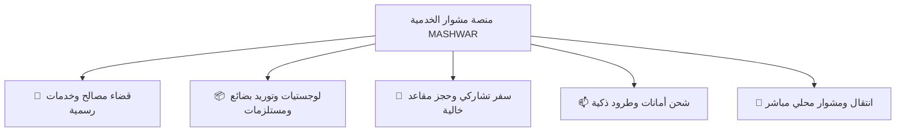

# مشوار (MASHWAR) — المنصة الخدمية الذكية المتكاملة للمواطنين والمسافرين

<p align="center">
  
  
  
  
  
  
  
</p>

<p align="center">
  <b>منصة خدمية متكاملة لتبادل المشاوير، قضاء المصالح الرسمية، توريد البضائع، ونقل الأمانات بين وداخل المحافظات المصرية</b><br/>
  <i>تطبيق إنتربرايز موثوق بالرقم القومي مع حماية كود التسليم الرقمي (4-Digit OTP)</i>
</p>

---

## 🌟 الرؤية والهدف الاستراتيجي (Vision & Overview)

يعالج تطبيق **مشوار (MASHWAR)** فجوة يومية يعيشها ملايين المواطنين في كافة المحافظات المصرية (بين القاهرة، الدلتا، الإسكندرية، والصعيد، وكذلك بين المراكز والقرى):
- **قضاء المصالح وتوفير عناء السفر:** بدل أن يسافر مواطن من كفر الشيخ أو دمنهور إلى القاهرة يوماً كاملاً لإنهاء مصلحة أو استلام ورقة رسمية؛ يتيح التطبيق نشر طلب لأي مسافر متواجد بالقاهرة ليقوم بقضاء المصلحة وجلب المستند بأمان بمقابل عادل.
- **دعم التجارة واللوجستيات:** تمكين أصحاب المحلات والأنشطة التجارية من طلب توصيل بضائع ومستلزمات لمواقعهم بسرعة فائقة دون الحاجة لشركات شحن بطيئة ومعقدة.
- **حل أزمة المواصلات بالسفر التشاركي:** عندما تكون وسائل المواصلات العامة مزدحمة أو غير متوفرة، يستطيع أي مواطن مسافر بسيارته نشر رحلته وتحديد عدد المقاعد الشاغرة (مثل 3 مقاعد) بسعر عادل للكرسي لتقاسم تكاليف الوقود وتوفير مقاعد مريحة وآمنة للركاب.
- **شحن الأمانات والطرود:** توصيل فوري في نفس اليوم مع مسافر موثوق وفي نفس اتجاه الرحلة.
- **تسهيل المشاوير والانتقالات المحلية المباشرة:** لخدمة المناطق التي تعاني من نقص في وسائل المواصلات اليومية.

---

## 🛡️ ركائز الأمان والتوثيق وحفظ الحقوق (Trust & Security)

يحفظ **مشوار** حقوق وسلامة الطرفين (طالب الخدمة ومقدم الخدمة) من خلال منظومة أمنية متكاملة:
1. **توثيق الهوية الوطنية (National ID Verification):** رفع صورة البطاقة الشخصية ورقم الهاتف القومي والتحقق من الهوية لكلا الطرفين لضمان المصداقية والأمان.
2. **كود التسليم الرقمي الآمن (4-Digit OTP Handover Code):** لا يتم تسليم الأوراق، البضائع، أو الأمانات، ولا تُعتبر المعاملة منتهية إلا بعد مطابقة كود OTP السري بين الطرفين.
3. **محادثات مباشرة مشفرة:** تواصل داخلي آمن يحفظ خصوصية أرقام الهواتف الشخصية.
4. **زر الطوارئ ومركز السلامة (SOS Safety Hub):** إمكانية مشاركة تفاصيل المشوار أو خط السير المباشر مع العائلة أو جهات الطوارئ بنقرة واحدة.

---

## 🚀 الخدمات الخمس الأساسية (Core Service Pillars)



### 1. 📄 قضاء مصالح وخدمات رسمية (Official Errands & Paperwork)
- استخراج وتخليص مستندات رسمية وأوراق حكومية وتوصيلها للمحافظات.
- توفير مشاوير السفر المرهقة ومصاريف التنقل العشوائية، والمحاسبة بنظام مالي عادل.

### 2. 📦 لوجستيات وتوريد بضائع (Cargo & Logistics Supply)
- خدمة مخصصة للمحلات والورش والمصانع والتجار.
- طلب توريد قطع غيار، خامات، كراتين، وبضائع تجارية ونقلها من مكان المورّد إلى موقع العمل مباشرة.

### 3. 🚗 سفر تشاركي ومقاعد شاغرة (Carpooling & Shared Seats)
- يستطيع السائق نشر مساره وعدد الكراسي المتاحة وتكلفتها (مثل 3 كراسي بين طنطا والقاهرة).
- يستطيع الراكب حجز مقعد مريح مع إمكانية اختيار **رحلات مخصصة للسيدات (Ladies Only)** ومعاينة الركاب المحجوزين في نفس السيارة مسبقاً (**Co-Passengers Preview**).

### 4. 📫 شحن أمانات وطرود ذكية (Smart Parcel Shipping)
- توصيل أمانات وطرود وشنط وأجهزة في نفس اليوم مع مسافر يمر بنفس خط السير.
- حماية تسليم تامة ومؤمنة بكود OTP وقائمة واضحة للممنوعات المشروعة.

### 5. 📍 انتقال ومشوار محلي مباشر (Direct Local Transport)
- خدمة المشاوير المحلية المباشرة للتنقل بين المراكز والقرى أو داخل المدن، وتوفير بدائل عملية وسريعة للمناطق التي تندر فيها المواصلات العامة.

---

## 📋 اللوحة المجتمعية التفاعلية (The Smart Community Board)

تمت إعادة هندسة لوحة الإعلانات بالكامل بنظام **التبديل الذكي للنية (Dual-Intent Master Switch)**:
- **أنا أطلب خدمة / مشوار:** مخصص لمن يحتاج قضاء مصلحة، نقل بضاعة، مقعد في سيارة، أو شحن طرد.
- **أنا مسافر / أقدم خدمة:** مخصص لمن لديه سيارة أو مسافر ومستعد لتقديم مساعدة، استلام شحنة، أو تشارك مقاعده الخالية.
- **بطاقة خط سير متصلة وعصرية (Connected Route Card):**
  - حقول إدخال أنيقة لنقطة الانطلاق وجهة الوصول.
  - زر عائم للتبديل السريع بين المدن (`⇅`).
  - نافذة اختيار منسقة تضم كافة المحافظات والمدن المصرية الـ 27 مع دعم البحث السريع.

---

## 📱 تجربة المستخدم والتصميم (UI/UX Design Standards)

- **أسلوب أوبر العالمي ونقاء التصميم (Minimalist Enterprise Standard):**
  - أسطح بيضاء نقية (`#FFFFFF`) وظلال ناعمة وإطارات دقيقة (0.8px).
  - إزالة كافة العناصر المشتتة والأشرطة المتكررة لتجربة استخدام فائقة السلاسة.
- **تصميم متجاوب بالكامل (Fully Responsive Multi-Viewport):**
  - يتكيف تلقائياً عبر الهواتف الضيقة (320px / 375px)، الأجهزة اللوحية (768px)، وشاشات الويب والكمبيوتر الكبيرة (1280px+).
  - شاشة موحدة ومريحة لتسجيل الدخول والترحيب، تضمن وضوح العناصر على كافة الشاشات دون انقسامات مشوهة.
- **إعدادات ذكية وتنبيهات مخصصة (Settings & Smart Notifications):**
  - التحكم في إشعارات الرحلات، الطرود، وعروض اللوحة القريبة في نطاق 50 كم.
  - قسم مدمج لإدارة **تنبيهاتي للمسارات المتابعة (My Route Alerts)** مع عداد ذكي بالتنبيهات النشطة.

---

## 🏗️ الهيكلية المعمارية للمشروع (Architecture)

تم بناء المشروع وفق مبادئ **Clean Layered Architecture** لضمان فصل المسؤوليات وتيسير التطوير والتوسع:

```text
lib/
├── core/                  # Design Tokens, AppTheme, Typography, Dimens, Global Widgets
│   ├── constants/         # AppColors, AppTypography, AppDimens
│   ├── localization/      # AppStrings, Translation Helpers (AR / EN)
│   ├── theme/             # Light AppTheme (Cairo Font, Minimal Enterprise)
│   └── widgets/           # MashwarButton, MashwarTextField, MashwarBadge, RouteMapView
├── data/                  # Models & Mock Repositories
│   ├── models/            # UserModel, RideModel, ParcelModel, BoardAdModel, RouteAlertModel
│   └── mock_data.dart     # Comprehensive Egyptian Scenarios (27 Governorates)
├── state/                 # State Management (MultiProvider)
│   ├── auth_provider.dart       # User Session, National ID Verification & Login State
│   ├── rides_provider.dart      # Ride Booking, Seat Management & Pricing
│   ├── parcels_provider.dart    # Parcel Transits & OTP Lifecycle
│   ├── board_provider.dart      # Community Ads, Offer Negotiation & Intent Filtering
│   ├── alerts_provider.dart     # Route Alerts & Notification Toggles
│   ├── settings_provider.dart   # Language (RTL/LTR) & Push Preference Controls
│   └── admin_provider.dart      # User Ban, KYC Verification & Dispute Resolution
├── screens/               # Feature-Driven Screens
│   ├── auth/              # Welcome, Phone Input (+20), Email Auth, OTP & Profile Setup
│   ├── home/              # Main Hub, Quick Search & Safety Pillars
│   ├── board/             # Community Board, Post Ad (Dual-Intent), Make Offer
│   ├── alerts/            # My Alerts Screen (Route Corridor Notification Management)
│   ├── ride_details/      # Passenger/Driver Perspectives, Seat Selection, Map Route
│   ├── parcel/            # Send Parcel, OTP Verification Dialog, Prohibited Items
│   ├── settings/          # Uber-Style Sectioned Settings & Smart Notification Hub
│   ├── wallet/            # InstaPay, Vodafone Cash, Cash Settlements & Receipts
│   ├── safety/            # SOS Safety Center, Live Trip Sharing & Police/Ambulance Hotlines
│   └── admin/             # Full Desktop/Web Admin Control Panel & Audit Logs
├── admin_main.dart        # Entrypoint for Admin Web Control Center
└── main.dart              # Entrypoint for Passenger, Driver & Service App
```

---

## 🧪 الاختبارات والجودة (Automated Tests & Quality)

يحظى المشروع بتغطية اختبارات متقدمة تضمن الجاهزية للإنتاج وخلوه التام من أخطاء الـ Layout Overflow أو تضارب الحالات:

```bash
# تشغيل جميع الاختبارات الآلية (65 اختباراً أخضر بنسبة 100%)
flutter test

# التحقق من خلو الكود من أي تحذيرات أو أخطاء
flutter analyze
```

**النتائج:**
- **`flutter test`:** 65/65 passed (`All tests passed!`).
- **`flutter analyze`:** `No issues found! (0 warnings, 0 errors)`.

---

## 🚦 تشغيل المشروع محلياً (Running Locally)

### المتطلبات
- Flutter SDK (3.x أو أحدث)
- متصفح ويب حديث أو محاكي Android / iOS

### 1. تثبيت الاعتماديات
```bash
flutter pub get
```

### 2. تشغيل تطبيق المواطنين والخدمات الأساسي
```bash
flutter run -d web-server --web-port 8080 --web-hostname localhost
```
افتح المتصفح على: [http://localhost:8080](http://localhost:8080)

### 3. تشغيل لوحة تحكم الإدارة (Admin Control Center)
```bash
flutter run -t lib/admin_main.dart -d web-server --web-port 8081 --web-hostname localhost
```
افتح المتصفح على: [http://localhost:8081](http://localhost:8081)

---

## 📄 الترخيص (License)

هذا المشروع مرخص بموجب رخصة **MIT**.  
جميع الحقوق محفوظة © 2026 **مشوار (MASHWAR)**.
