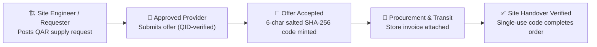

# مشوار (MASHWAR) — Qatar Worksite Supply & Field Procurement MVP

<p align="center">
  
  
  
  
  
  
</p>

<p align="center">
  <b>منصة تنسيق توريد مستلزمات ومشتريات مواقع العمل في دولة قطر</b><br/>
  <i>Qatar B2B / Contractor Worksite Supply Coordination — Verified Providers, Invoice Proof & Cryptographic Handover Verification</i>
</p>

---

## 1. Product Overview (نظرة عامة على المنتج — المرحلة التجريبية الأولى)

**MASHWAR (مشوار)** Phase 1 MVP is a focused **Worksite Supply & Urgent Field Material Coordination** platform built for contractors, site engineers, maintenance teams, and approved supply runners operating across the **State of Qatar**.

Instead of losing skilled technician hours on traffic runs to hardware stores and wholesale yards, a site requester posts a structured supply order (items, specifications, pickup store/zone, target worksite, and QAR budget). Admin-approved providers submit transparent offers, procure the items with store invoice proof, deliver them to the worksite, and complete the job only after verifying a single-use 6-character handover code with the site contact.

### Core Qatar Corridors & Hubs
- **Supply Origins:** Doha Industrial Area (`المنطقة الصناعية`), Salwa Road hardware yards, Al Wakrah supply depots, Al Rayyan wholesale stores.
- **Worksite Destinations:** Doha (`الدوحة`), Lusail (`لوسيل`), Al Rayyan (`الريان`), Al Wakrah (`الوكرة`), Al Khor (`الخور`), Mesaieed (`مسيعيد`), Ras Laffan (`رأس لفان`), Umm Salal (`أم صلال`), Al Daayen (`الضعاين`), and Al Shahaniya (`الشيحانية`).



---

## 2. MVP Scope, Deferred Features & Regulatory / Trademark Notice

### Active Phase 1 Scope (`AppEnvironment` Flags)
 Controlled centrally in [`lib/core/config/app_environment.dart`](lib/core/config/app_environment.dart):

| Capability | Flag | Phase 1 Status | Rationale |
| :--- | :--- | :---: | :--- |
| **Worksite Supply Coordination** | `enableWorksiteSupply` | **`true` (Active)** | Core B2B/site procurement & delivery coordination in Qatar (`QAR`). |
| **Passenger Rides** | `enablePassengerRides` | `false` (Deferred) | Deferred pending Qatar Ministry of Transport (MoT) passenger transport licensing. |
| **Paid Carpooling** | `enableCarpooling` | `false` (Deferred) | Deferred pending Qatar MoT shared-mobility regulatory approval. |
| **Commercial Heavy Cargo** | `enableCommercialCargo` | `false` (Deferred) | Deferred pending commercial freight/transport licensing. |
| **In-App Digital Wallet** | `enableDigitalWallet` | `false` (Deferred) | Deferred pending Qatar Central Bank (QCB) stored-value & PSP compliance. |
| **Automated Escrow Custody** | `enableEscrowClaims` | `false` (Deferred) | Deferred pending QCB-compliant escrow custody & licensed PSP integration. |
| **AI Matching & Super-App Modules** | — | Deferred | Multi-category super-app flows remain disabled behind feature flags in Phase 1. |

> **Pilot Settlement Model:** Phase 1 supports **`cash_on_delivery`** (Cash on Delivery at the worksite) and **`bank_transfer_manual`** (Manual Bank Transfer with uploaded transfer proof verified by operations staff: `unpaid -> transfer_proof_submitted -> verified_settled`). No customer funds are held in automated in-app wallet custody.

### Legal, Regulatory & Trademark Readiness Notice
- **No Transport or Financial Custody License Held:** The repository owner holds **no** passenger transport or commercial freight license from the Qatar Ministry of Transport (MoT) and **no** Payment Service Provider (PSP), e-money wallet, or financial escrow license from the Qatar Central Bank (QCB). Regulated transport and custodial payment modules are disabled in code (`false`) until formal licensing and licensed partner onboarding are completed.
- **Trademark Clearance Prerequisite:** Commercial use of the **MASHWAR / مشوار** name and mark in the State of Qatar requires independent legal trademark search and registration with the Ministry of Commerce and Industry (MoCI). Any third-party institutions or payment networks referenced in deferred legacy modules remain the property of their respective owners with no implied partnership or endorsement.

---

## 3. Implemented Technical Architecture

### Runtime Flavors & Fail-Closed Mock Boundary
Configured via compile-time `--dart-define` parameters (see [`.env.example`](.env.example)):
- `APP_ENV`: `development` | `staging` | `production` (parsed into `AppFlavor`; defaults to `development`).
- `USE_FIREBASE`: `true` | `false` — when omitted, real app entrypoints (`lib/main.dart`, `lib/admin_main.dart`) connect to Firebase project `mashwar-qatar-2026-ec99d` (`europe-west1`) by default (`AppEnvironment.isFirebaseRuntimeActive == true`, `AppRepositories.instance.useFirebase()`) unless `USE_DEV_MOCKS=true` is explicitly passed in `development`. Passing `USE_FIREBASE=false` without `USE_DEV_MOCKS=true` fails closed with a configuration error.
- `USE_DEV_MOCKS`: `true` | `false` — **strictly gated** by `AppEnvironment.resolveUseDevMocks` so local dev mocks can **only** activate when `APP_ENV == 'development'` and Firebase is disabled. Staging and production builds fail closed to `ServiceUnavailableScreen` with retry if Firebase is disabled or unreachable, never leaking mock users or fake balances.

### Qatar Domain & Financial Standards
- **Integer Minor-Unit Currency (`MoneyMinor`):** All MVP financial fields (`budgetMinor`, `estimatedItemsCostMinor`, `maxItemsCapMinor`, `deliveryFeeBudgetMinor`, `agreedAmountMinor`, `agreedFeeMinor`, `totalAmountMinor`, `serviceFeeMinor`) use integer minor units (`1 QAR = 100 dirhams`, e.g., `15000` = `150.00 QAR` / `150 ر.ق`) with zero floating-point `double` arithmetic.
- **Qatar Identity & Phone Validation:** Providers submit an **11-digit Qatar ID (QID)** (`^[0-9]{11}$`); Qatar mobile numbers validate against 8-digit Ooredoo/Vodafone Qatar prefixes (`+974` `[3567]xxxxxxx`).
- **Cryptographic Handover Verification:** When a requester accepts an offer, `acceptWorkOffer` generates a 6-character unambiguous alphanumeric code (`[A-HJ-NP-Z2-9]`), hashes it with a 128-bit per-request salt (`SHA-256(salt + ':' + code)`), stores the digest in server-only `work_request_secrets/{requestId}` (`allow read, write: if false;`), and exposes the plaintext code exclusively to the requester via `work_request_handover_view/{requestId}`. `verifyHandoverAndComplete` enforces constant-time comparison (`crypto.timingSafeEqual`), a **5-attempt limit**, **24-hour TTL**, and **single-use** completion.

### Repository Layout
```text
├── .env.example                 # Environment & --dart-define template (zero secrets)
├── firebase.json                # Firestore, Cloud Functions v2 (nodejs20), Storage & Emulator ports
├── firestore.rules              # 2,552-line AST-optimized ruleset (Collections 1–19 + MVP Collections 20–29)
├── firestore.indexes.json       # 14 composite indexes (incl. Worksite Supply queries)
├── storage.rules                # Private KYC & participant-scoped invoice/proof image rules (<=10 MB)
├── scripts/                     # Local automation (run_emulators_tests.ps1, fetch_firebase_configs.ps1, generate_upload_keystore.ps1)
├── functions/                   # Firebase Cloud Functions v2 (TypeScript, europe-west1)
│   ├── src/
│   │   ├── types.ts             # Domain types, DTOs & error codes
│   │   ├── stateMachine.ts      # WorkRequest & PaymentSettlement state transition guards
│   │   ├── handoverCrypto.ts    # CSPRNG 6-char code + salted constant-time SHA-256 verification
│   │   ├── store.ts             # Transactional Firestore & in-memory test store adapter
│   │   ├── handlers.ts          # 10 transactional business, account erasure & admin moderation handlers
│   │   └── index.ts             # Cloud Functions v2 HTTPS onCall exports (incl. deleteUserAccount)
│   └── test/
│       ├── backend_security.test.mjs  # Node security & state-machine test suite (11/11 passing)
│       └── emulator_rules.test.mjs    # Live Firestore & Storage Emulator rules suite (10/10 passing)
├── lib/
│   ├── core/config/             # AppEnvironment, AppFlavor, feature flags & legal disclaimers
│   ├── data/
│   │   ├── models/              # worksite_models.dart (MoneyMinor, WorkRequest, WorkOffer, etc.), user_model.dart
│   │   ├── repositories/        # Contracts + Firebase (+974 Phone & Email Auth) & dev-gated local implementations
│   │   └── services/            # firebase_firestore_service.dart (Callable HTTP v2), media_upload_service.dart (Storage), google_maps_service.dart
│   ├── state/                   # WorksiteProvider, AuthProvider, AdminProvider, SettingsProvider
│   ├── screens/                 # Customer Worksite Supply flows, Auth, Safety (url_launcher), Legal (PDPL), Admin Portal (Module 13)
│   ├── main.dart                # Customer & embedded route entrypoint
│   └── admin_main.dart          # Standalone Enterprise Admin Web entrypoint (Firebase staff auth guarded)
└── docs/
    ├── MVP_BASELINE_AUDIT.md                  # Pre-implementation baseline audit (preserved reference)
    ├── MVP_IMPLEMENTATION_REPORT.md           # Full MVP engineering & verification report
    ├── QATAR_COMPLIANCE_AND_RELEASE_PLAYBOOK.md # MoCI trademark, +974 SMS, PDPL & mobile store release playbook
    └── backend/                               # Aligned architecture, schema, API, security, setup & testing docs
```

---

## 4. Running & Verifying Locally

### Prerequisites
- **Flutter SDK** `3.x` (verified on `Flutter 3.47.9` / `Dart 3.x`)
- **Node.js** `20+` (verified on `v24.19.0`) for `functions/` build and tests
- **OpenJDK `21 LTS`** (`21.0.13.1`, discoverable via `$env:JAVA_HOME` or `$env:LOCALAPPDATA\Programs\OpenJDK21`) and **`firebase-tools`** (`15.37.0+`) for the live Firestore & Storage Emulator test suite and Android keystore tooling

### 1. Install Dependencies & Provision Local Ignored Native Configs
```powershell
flutter pub get
Push-Location functions; npm install; Pop-Location

# Optional (for native Android/iOS builds): fetch gitignored google-services.json & GoogleService-Info.plist
# and generate gitignored android/upload-keystore.jks + android/key.properties
powershell -ExecutionPolicy Bypass -File scripts/fetch_firebase_configs.ps1
powershell -ExecutionPolicy Bypass -File scripts/generate_upload_keystore.ps1
```

### 2. Run Customer App
```powershell
# Default: connects directly to Firebase project mashwar-qatar-2026-ec99d
flutter run -d chrome

# Explicit local development with dev mock data (APP_ENV=development & USE_FIREBASE=false)
flutter run -d chrome --dart-define=APP_ENV=development --dart-define=USE_FIREBASE=false --dart-define=USE_DEV_MOCKS=true
```

### 3. Run Admin Operations Portal (`Module 13: Worksite Supply Ops`)
```powershell
# Default: live Firebase staff auth mode (verifies active Firestore admin_staff/{uid} record)
flutter run -t lib/admin_main.dart -d chrome

# Dev-mock staff mode (local testing only)
flutter run -t lib/admin_main.dart -d chrome --dart-define=APP_ENV=development --dart-define=USE_FIREBASE=false --dart-define=USE_DEV_MOCKS=true
```

### 4. Run Static Analysis, Unit/Widget Suites & Live Emulator Security Tests
```powershell
flutter analyze --no-pub
flutter test --no-pub                                           # 139/139 passing
Push-Location functions; npm run build; npm test; Pop-Location  # 11/11 passing
powershell -ExecutionPolicy Bypass -File scripts/run_emulators_tests.ps1  # 10/10 live Firestore + Storage suites passing
flutter build web --release                                     # Production consumer web bundle
flutter build web --release -t lib/admin_main.dart --base-href /admin/ -o build/web/admin  # Admin web bundle
```

---

## 5. Remaining External & Pre-Launch Operational Gates

All in-repository MVP code, security rules, media upload pipelines, `+974` Phone Auth integration, `deleteUserAccount` erasure, native Firebase app registrations (`1:820084343406:android:a9e464e38a988eddd35c7f`, `1:820084343406:ios:5073f983643cc020d35c7f`, `1:820084343406:web:ad6ce9779a06584bd35c7f`), release signing configs, and live emulator suites are implemented and verified. Remaining gates are external operational/legal steps documented in [`docs/QATAR_COMPLIANCE_AND_RELEASE_PLAYBOOK.md`](docs/QATAR_COMPLIANCE_AND_RELEASE_PLAYBOOK.md):

1. **Firebase Console SMS Billing, App Attestation & Live `+974` SIM Verification:** `+974` Firebase Phone Auth (`signInWithPhoneNumber` on Web, `verifyPhoneNumber` on Android/iOS) is wired with bilingual fallback to Email + Password, but live SMS delivery requires upgrading `mashwar-qatar-2026-ec99d` to the Firebase Blaze plan, enabling Phone Auth with a Qatar-only (`+974`) SMS region allowlist, registering Android SHA-1/SHA-256 fingerprints + iOS APNs `.p8` key + reCAPTCHA Enterprise, and verifying OTP delivery on physical Ooredoo/Vodafone Qatar SIMs.
2. **Signed Native Store Artifacts & Store Console Review:** Release Gradle signing (`android/app/build.gradle.kts` + `proguard-rules.pro`), iOS `qa.mashwar.app` bundle/privacy strings (`ios/Runner/Info.plist`), and local provisioning scripts (`fetch_firebase_configs.ps1`, `generate_upload_keystore.ps1`) are ready, while building production `.aab` / `.ipa` store binaries requires an Android SDK release host and macOS/Xcode Apple Developer signing host, plus Google Play Console / App Store Connect review.
3. **Qatar MoCI Trademark Clearance:** Complete prior-art search and Nice Classes 35, 39, and 42 trademark registration for **MASHWAR / مشوار** via the Qatar Ministry of Commerce and Industry (MoCI) Single Window (`investor.sw.gov.qa`) prior to public commercial launch.
4. **Qatar MoT & QCB Regulatory Authorization (Deferred Phase 2 Flags):** Keep `enablePassengerRides`, `enableCarpooling`, `enableCommercialCargo`, `enableDigitalWallet`, and `enableEscrowClaims` set to `false` until formal Ministry of Transport (MoT) permits and Qatar Central Bank (QCB) PSP/escrow authorizations are obtained.

---

## 6. Documentation Index
- [MVP Implementation & Verification Report](docs/MVP_IMPLEMENTATION_REPORT.md)
- [Qatar Compliance, Trademark & Mobile Release Playbook](docs/QATAR_COMPLIANCE_AND_RELEASE_PLAYBOOK.md)
- [Backend Architecture](docs/backend/ARCHITECTURE.md)
- [Cloud Firestore Database Schema (Collections 1–29)](docs/backend/DATABASE_SCHEMA.md)
- [Callable Cloud Functions v2 & State Machine API](docs/backend/API_AND_FUNCTIONS.md)
- [Security Architecture, Rules & Governance](docs/backend/SECURITY.md)
- [Firebase & Local Emulator Setup](docs/backend/FIREBASE_SETUP.md)
- [Google Maps & Qatar Geo-Catalog Setup](docs/backend/GOOGLE_MAPS_SETUP.md)
- [Implementation Status Matrix](docs/backend/IMPLEMENTATION_STATUS.md)
- [Testing & Verification Report](docs/backend/TESTING_REPORT.md)
- [Interactive Controls Matrix](docs/backend/INTERACTIVE_CONTROLS_MATRIX.md)

---

## License

Released under the **MIT License**. © 2026 MASHWAR (مشوار).
