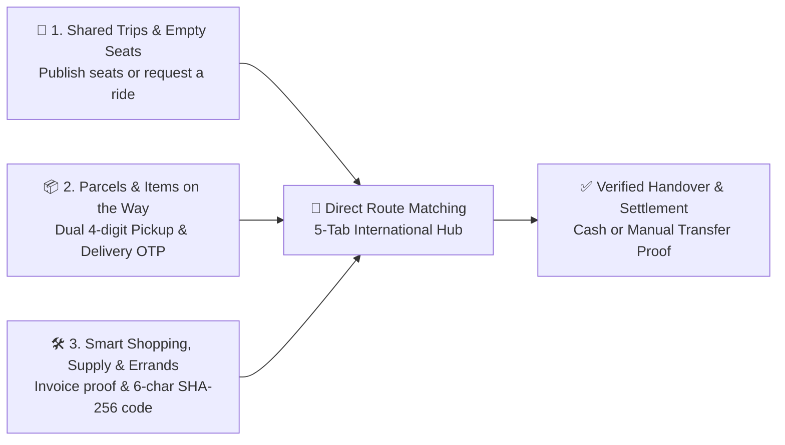

# مشوار (MASHWAR) — International 3-Service Mobility, Route Parcels & Smart Supply Platform

<p align="center">
  
  
  
  
  
  
</p>

<p align="center">
  <b>منصة عالمية ثلاثية الخدمات تجمع الرحلات التشاركية والطرود على الطريق والتوريد الذكي</b><br/>
  <i>Shared Trips & Empty Seats · Parcels & Items on the Way · Smart Shopping, Supply & Errands</i>
</p>

---

## 1. Product Overview (نظرة عامة على المنصة ثلاثية الخدمات)

**MASHWAR (مشوار)** is an international, bidirectional 3-service mobility, parcel-on-route, and smart fulfillment platform built with a clean global visual system (Navy `#0F172A`, Cobalt `#2563EB`, Indigo `#4F46E5`, Emerald `#10B981`, and Slate `#F8FAFC` — zero regional Sadu strips or single-country lock-in chrome):

1. **Shared Trips & Empty Seats (`سفر ومقاعد تشاركية`):** Travelers publish intercity or daily trips with `1..6` empty car seats (`PublishRideScreen` 3-step wizard), while passengers browse live corridors or post destination ride requests (`TripsAndParcelsHubScreen` & `PostAdScreen`) to receive direct offers (`MakeOfferSheet`).
2. **Parcels & Items on the Way (`طرود وأغراض مع مسافر`):** Travelers optionally enable **"Carry Parcels / Items Along Your Route"** (`publish_accepts_parcels_switch`) with package-size limits (`envelope`, `small`, `medium`), while senders ship documents or items directly with an active traveler or as an open route request (`SendParcelScreen` -> `ParcelTrackingScreen`) protected by **dual 4-digit Pickup & Delivery OTPs**.
3. **Smart Shopping, Supply & Errands (`شراء وتوريد ومهام خاصة`):** Requesters and contractors post structured shopping, hardware, and site supply orders (`CreateWorkRequestScreen`), receive competing offers from verified providers, review store invoice photos, and confirm completion via a single-use **6-character salted SHA-256 handover code**.



---

## 2. Platform Scope, Feature Flags & Settlement Model

### Active Platform Scope (`AppEnvironment` Flags)
Controlled centrally in [`lib/core/config/app_environment.dart`](lib/core/config/app_environment.dart):

| Capability | Flag | Status | Rationale |
| :--- | :--- | :---: | :--- |
| **Shared Trips & Empty Seats** | `enablePassengerRides` | **`true` (Active)** | Pillar 1: Bidirectional shared trips, seat bookings & passenger route requests. |
| **Carpooling & Route Parcels** | `enableCarpooling` | **`true` (Active)** | Pillar 1 & 2: Empty-seat cost sharing & parcels carried along a traveler's route with dual 4-digit OTPs. |
| **Smart Supply & Errands** | `enableWorksiteSupply` | **`true` (Active)** | Pillar 3: Structured shopping, site supply & errands with invoice proof & 6-char handover verification. |
| **Commercial Heavy Cargo** | `enableCommercialCargo` | `false` (Deferred) | Heavy commercial fleet freight dispatch remains gated separately. |
| **In-App Digital Wallet** | `enableDigitalWallet` | `false` (Deferred) | Stored-value wallet custody remains disabled in favor of direct settlement. |
| **Automated Escrow Custody** | `enableEscrowClaims` | `false` (Deferred) | Automated PSP escrow custody remains disabled (`cash_on_delivery` / `bank_transfer_manual` + OTP). |

> **Direct Settlement Model:** MASHWAR uses **`cash_on_delivery`** (Cash on Handover) and **`bank_transfer_manual`** (Direct Bank Transfer with uploaded transfer proof: `unpaid -> transfer_proof_submitted -> verified_settled`), paired with store invoice verification and cryptographic OTP handover codes without holding stored-value wallet balances.

### Legal, Regulatory & Trademark Readiness Notice
- **No Transport or Financial Custody License Held:** The repository owner holds **no** passenger transport or commercial freight license from the Qatar Ministry of Transport (MoT) and **no** Payment Service Provider (PSP), e-money wallet, or financial escrow license from the Qatar Central Bank (QCB). Regulated transport and custodial payment modules are disabled in code (`false`) until formal licensing and licensed partner onboarding are completed.
- **Trademark Clearance Prerequisite:** Commercial use of the **MASHWAR / مشوار** name and mark in the State of Qatar requires independent legal trademark search and registration with the Ministry of Commerce and Industry (MoCI). Any third-party institutions or payment networks referenced in deferred legacy modules remain the property of their respective owners with no implied partnership or endorsement.

---

## 3. Implemented Technical Architecture

### Runtime Flavors & Fail-Closed Mock Boundary
Configured via compile-time `--dart-define` parameters (see [`.env.example`](.env.example)):
- `APP_ENV`: `development` | `staging` | `production` (parsed into `AppFlavor`; defaults to `development`).
- `USE_FIREBASE`: `true` | `false` — when omitted, real app entrypoints (`lib/main.dart`, `lib/admin_main.dart`) connect to Firebase project `mashwar-qatar-2026-ec99d` (`europe-west1`) by default (`AppEnvironment.isFirebaseRuntimeActive == true`, `AppRepositories.instance.useFirebase()`) unless `USE_DEV_MOCKS=true` is explicitly passed in `development`. Passing `USE_FIREBASE=false` without `USE_DEV_MOCKS=true` fails closed with a configuration error.
- `USE_DEV_MOCKS`: `true` | `false` — **strictly gated** by `AppEnvironment.resolveUseDevMocks` so local dev mocks can **only** activate when `APP_ENV == 'development'` and Firebase is disabled. Staging and production builds fail closed to `ServiceUnavailableScreen` with retry if Firebase is disabled or unreachable, never leaking mock users or fake balances.

### Qatar Domain & Financial Standards
- **Integer Minor-Unit Currency (`MoneyMinor`):** All MVP financial fields (`budgetMinor`, `estimatedItemsCostMinor`, `maxItemsCapMinor`, `deliveryFeeBudgetMinor`, `agreedAmountMinor`, `agreedFeeMinor`, `totalAmountMinor`, `serviceFeeMinor`) use integer minor units (`1 QAR = 100 dirhams`, e.g., `15000` = `150.00 QAR` / `150 ر.ق`) with zero floating-point `double` arithmetic.
- **Qatar Identity & Phone Validation:** Providers submit an **11-digit Qatar ID (QID)** (`^[0-9]{11}$`); Qatar mobile numbers validate against 8-digit Ooredoo/Vodafone Qatar prefixes (`+974` `[3567]xxxxxxx`).
- **Cryptographic Handover Verification:** When a requester accepts an offer, `acceptWorkOffer` generates a 6-character unambiguous alphanumeric code (`[A-HJ-NP-Z2-9]`), hashes it with a 128-bit per-request salt (`SHA-256(salt + ':' + code)`), stores the digest in server-only `work_request_secrets/{requestId}` (`allow read, write: if false;`), and exposes the plaintext code exclusively to the requester via `work_request_handover_view/{requestId}`. `verifyHandoverAndComplete` enforces constant-time comparison (`crypto.timingSafeEqual`), a **5-attempt limit**, **24-hour TTL**, and **single-use** completion.

### Repository Layout
```text
├── .env.example                 # Environment & --dart-define template (zero secrets)
├── firebase.json                # Auth (Email/Password), Firestore, Cloud Functions v2 (nodejs20), Storage & Emulators
├── firestore.rules              # 2,552-line AST-optimized ruleset (Collections 1–19 + MVP Collections 20–29)
├── firestore.indexes.json       # 14 composite indexes (incl. Worksite Supply queries)
├── storage.rules                # Private KYC & participant-scoped invoice/proof image rules (<=10 MB)
├── scripts/                     # Automation (provision_firebase_auth.ps1, seed_demo_all_cases.ps1/.mjs, run_emulators_tests.ps1, fetch_firebase_configs.ps1, generate_upload_keystore.ps1)
├── functions/                   # Firebase Cloud Functions v2 (TypeScript, europe-west1)
│   ├── src/
│   │   ├── types.ts             # Domain types, DTOs & error codes
│   │   ├── stateMachine.ts      # WorkRequest & PaymentSettlement state transition guards
│   │   ├── handoverCrypto.ts    # CSPRNG 6-char code + salted constant-time SHA-256 verification
│   │   ├── store.ts             # Transactional Firestore & in-memory test store adapter
│   │   ├── handlers.ts          # 10 transactional business, account erasure & admin moderation handlers
│   │   └── index.ts             # Cloud Functions v2 HTTPS onCall exports (incl. deleteUserAccount)
│   └── test/
│       ├── backend_security.test.mjs  # Node security & state-machine test suite (11/11 passing)
│       └── emulator_rules.test.mjs    # Live Firestore & Storage Emulator rules suite (10/10 passing)
├── lib/
│   ├── core/config/             # AppEnvironment, AppFlavor, feature flags & legal disclaimers
│   ├── core/widgets/            # mashwar_worksite_icons.dart, mashwar_animations.dart, qatar_live_map_canvas.dart
│   ├── data/
│   │   ├── demo/                # MashwarDemoCasesCatalog (14 Qatar worksite cases, 11 statuses, 8 providers, 5 handover codes)
│   │   ├── models/              # worksite_models.dart (MoneyMinor, WorkRequest, WorkOffer, etc.), user_model.dart
│   │   ├── repositories/        # Contracts + Firebase (+974 Phone, Email Auth, Spark-safe Firestore fallbacks) & dev-gated local implementations
│   │   └── services/            # firebase_firestore_service.dart (Callable HTTP v2), media_upload_service.dart (Storage), google_maps_service.dart
│   ├── state/                   # WorksiteProvider, AuthProvider, AdminProvider, SettingsProvider
│   ├── screens/                 # Customer Worksite Supply flows, Auth, Safety (url_launcher), Legal (PDPL), Admin Portal (Module 13)
│   ├── main.dart                # Customer & embedded route entrypoint
│   └── admin_main.dart          # Standalone Enterprise Admin Web entrypoint (Firebase staff auth guarded)
└── docs/
    ├── MVP_BASELINE_AUDIT.md                  # Pre-implementation baseline audit (preserved reference)
    ├── MVP_IMPLEMENTATION_REPORT.md           # Full MVP engineering & verification report
    ├── QATAR_COMPLIANCE_AND_RELEASE_PLAYBOOK.md # MoCI trademark, +974 SMS, PDPL & mobile store release playbook
    └── backend/                               # Aligned architecture, schema, API, security, setup & testing docs
```

---

## 4. Running & Verifying Locally

### Prerequisites
- **Flutter SDK** `3.x` (verified on `Flutter 3.47.9` / `Dart 3.x`)
- **Node.js** `20+` (verified on `v24.19.0`) for `functions/` build and tests
- **OpenJDK `21 LTS`** (`21.0.13.1`, discoverable via `$env:JAVA_HOME` or `$env:LOCALAPPDATA\Programs\OpenJDK21`) and **`firebase-tools`** (`15.37.0+`) for the live Firestore & Storage Emulator test suite and Android keystore tooling

### 1. Install Dependencies & Provision Local Ignored Native Configs
```powershell
flutter pub get
Push-Location functions; npm install; Pop-Location

# Idempotently provision Firebase Auth (Email/Password) and localhost/127.0.0.1 authorizedDomains
powershell -ExecutionPolicy Bypass -File scripts/provision_firebase_auth.ps1

# Seed live Firestore demo cases across all 11 WorkRequestStatus values, grant superAdmin claim to QB0hyc4BVZTkr91EC9KUd2EFbCw1, and verify readback
powershell -ExecutionPolicy Bypass -File scripts/seed_demo_all_cases.ps1 -DeployRulesAndIndexes
powershell -ExecutionPolicy Bypass -File scripts/seed_demo_all_cases.ps1 -VerifyOnly

# Optional (for native Android/iOS builds): fetch gitignored google-services.json & GoogleService-Info.plist
# and generate gitignored android/upload-keystore.jks + android/key.properties
powershell -ExecutionPolicy Bypass -File scripts/fetch_firebase_configs.ps1
powershell -ExecutionPolicy Bypass -File scripts/generate_upload_keystore.ps1
```

### 2. Run Customer App & All-Cases Demo Showcase
```powershell
# Default: connects directly to Firebase project mashwar-qatar-2026-ec99d
# In development builds, HomeScreen displays a compact "Load All Demo Cases (14)" toggle (WorksiteProvider.activateDemoShowcase)
flutter run -d chrome

# Explicit local development with dev mock data (APP_ENV=development & USE_FIREBASE=false)
flutter run -d chrome --dart-define=APP_ENV=development --dart-define=USE_FIREBASE=false --dart-define=USE_DEV_MOCKS=true
```

#### Demo Dataset, Admin Claim & Deterministic Handover Test Codes
- **Primary Seeded Auth & Admin Account:** UID `QB0hyc4BVZTkr91EC9KUd2EFbCw1` (`abdelrahmanmahana01@gmail.com`) provisioned with Firebase Auth custom claim `{ "admin": true, "role": "superAdmin" }`, active `admin_staff/QB0hyc4BVZTkr91EC9KUd2EFbCw1`, and an approved `provider_profiles` entry (`MashwarDemoCasesCatalog`).
- **All-Cases Demo Coverage (`lib/data/demo/demo_cases_catalog.dart`):** 14 Qatar worksite supply requests covering all **11** `WorkRequestStatus` values, all **7+** Qatar municipalities/hubs, both `PaymentMethod`s (`cash_on_delivery`, `bank_transfer_manual`), all **4** `PaymentSettlementStatus` values, 8 providers across all **4** `ProviderApprovalStatus` values, 3 `SavedWorksite`s, 3 competing offers on `demo_wr_03_offers_mine` (13 live `work_offers` seeded across active/completed/disputed requests), timelines, ratings, bilingual notifications, Qatar `investor_inquiries`, and `admin_audit_logs` (`99 / 99` documents verified in live Firestore).
- **Spark-Safe Behavior:** `FirebaseWorksiteRepository` executes client-permitted Firestore operations directly when Cloud Functions v2 return `not-found`/`unavailable` on Spark, while throwing clear bilingual `WorksiteRepositoryException`s for Blaze/Admin-SDK gated actions (`acceptWorkOffer`, `verifyHandoverAndComplete`, `submitOffer` `offerCount` update, `verified_settled`).
- **6-Char Handover Verification Test Codes (Salted SHA-256):**
  - `demo_wr_06_accepted`: `K7M4P9`
  - `demo_wr_07_in_prog`: `Q9R3W8`
  - `demo_wr_08_picked_up`: `M4N8X2`
  - `demo_wr_09_transit`: `H6P2V5`
  - `demo_wr_10_deliv_pend`: `T5K9B3` *(assigned to `QB0hyc4BVZTkr91EC9KUd2EFbCw1` as provider so you can verify `delivered_pending_confirmation -> completed`)*

### 3. Run Admin Operations Portal (`Module 13: Worksite Supply Ops`)
```powershell
# Default: live Firebase staff auth mode (verifies active Firestore admin_staff/{uid} record)
flutter run -t lib/admin_main.dart -d chrome

# Dev-mock staff mode (local testing only)
flutter run -t lib/admin_main.dart -d chrome --dart-define=APP_ENV=development --dart-define=USE_FIREBASE=false --dart-define=USE_DEV_MOCKS=true
```

### 4. Run Static Analysis, Unit/Widget Suites & Live Emulator Security Tests
```powershell
flutter analyze --no-pub
flutter test --no-pub                                           # 161/161 passing (incl. Wave 9 International 3-Services E2E suite)
Push-Location functions; npm run build; npm test; Pop-Location  # 11/11 passing
powershell -ExecutionPolicy Bypass -File scripts/run_emulators_tests.ps1  # 10/10 live Firestore + Storage suites passing
flutter build web --release --dart-define=USE_FIREBASE=true                                              # Production consumer web bundle
flutter build web --release -t lib/admin_main.dart --base-href /admin/ -o build/web/admin --dart-define=USE_FIREBASE=true  # Admin web bundle
```

### Wave 9 International 3-Service Architecture & Global Brand Summary
- **Three Unified Bidirectional Services:**
  1. **Shared Trips & Empty Seats (`سفر ومقاعد تشاركية`):** 3-step `PublishRideScreen` traveler wizard (`1..6` empty seats, flexible `5..2000` contribution, optional stopover, and **"Carry Parcels / Items Along Your Route"** toggle) synced across `RidesProvider` & `BoardProvider`, paired with `TripsAndParcelsHubScreen` (`hub_tab_trips` & `hub_tab_requests`), `PostAdScreen`, and `MakeOfferSheet`.
  2. **Parcels & Items on the Way (`طرود وأغراض مع مسافر`):** 3-step `SendParcelScreen({ride, initialFromCity, initialToCity})` supporting direct dispatch with a parcel-friendly traveler (`RideDetailsScreen` dual CTA `ride_details_send_parcel_btn`) or standalone open route requests mirrored to `BoardProvider`, plus `ParcelTrackingScreen` displaying **dual 4-digit Pickup & Delivery OTPs**.
  3. **Smart Shopping, Supply & Errands (`شراء وتوريد ومهام خاصة`):** `CreateWorkRequestScreen`, `WorkRequestsFeedScreen`, and `WorkRequestDetailsScreen` with verified store receipts, `MoneyMinor` integer accounting, and 6-character salted SHA-256 handover verification.
- **3-Step Visual Journey, Wizard Headers & 5-Tab Navigation:** Added `MashwarThreeStepsBanner`, `MashwarWizardStepHeader` (`1 -> 2 -> 3` step pills), custom duotone `MashwarServicePillarIcon` vector emblems, and the 5-tab `MainNavShell` (`الرئيسية` / `Home`, `الرحلات والطرود` / `Trips & Parcels`, `التوريد والمهام` / `Supply & Tasks`, `نشاطي` / `My Activity` with `All`/`Trips`/`Parcels`/`Supply` filters, and `حسابي` / `Account`).
- **Complete Removal of Regional Sadu & Lock-In Chrome:** Neutralized `QatarSaduAccentBar` (`SizedBox.shrink()` -> `0.0` height) and removed regional maroon/Sadu strips and single-vertical lock-in phrasing across `HomeScreen` (`"إلى أين مشوارك أو طلبك اليوم؟"` / `"Where does your journey take you today?"`), `WelcomeScreen`, `SplashScreen`, `EmailInputScreen`, `CitySearchModal` (1-tap custom city entry), `ServiceEscrowScreen`, and `WalletScreen`.

### Wave 8 UI/UX & Marketplace Polish Summary
- **Photography & Custom Vector System:** Added `assets/images/mvp_hero_lusail_supply.jpg` and `assets/images/cat_tools_ppe.jpg`, plus `lib/core/widgets/mashwar_worksite_icons.dart` (`MashwarCategoryIcon`, `MashwarCategoryVisualBanner` with photography + `electrical`/`plumbing` `CustomPainter` dioramas, and `MashwarTrustEmblem`) and `lib/core/widgets/mashwar_animations.dart` (`MashwarShimmerBox`, `MashwarHoverCard`, `MashwarWorksiteStatusStepper`, `MashwarAttachmentThumbnail`, `MashwarImagePreviewDialog`).
- **Feed, Create & Details Upgrades:** Added search/category/perspective filters & `WorksiteSortOption` sorting on `WorkRequestsFeedScreen`; 4 1-tap Qatar templates, custom deadline picker, and live QAR cost calculator (`create_live_cost_summary`) on `CreateWorkRequestScreen`; and status stepper, smart offer comparison badges (`Lowest Price`, `Fastest ETA`, `Top Rated`), requester `cancelRequest`, and provider `withdrawOffer` on `WorkRequestDetailsScreen`.
- **Home, Shell & Account Compliance:** Upgraded `HomeScreen` (Lusail hero, category grid, live `QatarLiveMapCanvas` corridor map, trust pillars, clickable notifications strip), `MainNavShell` (unread badges & activity role filters/steppers), real `NotificationsCenterScreen` (`WorksiteNotificationItem`, unread filter, mark-read/mark-all-read, navigation to `WorkRequestDetailsScreen`), `WelcomeScreen`, and Qatar MVP `UserProfileScreen` / `HelpSupportScreen` (`+974 4400 9999`, `ops@mashwar.qa`).

---

## 5. Remaining External & Pre-Launch Operational Gates

All in-repository MVP code, security rules, media upload pipelines, `+974` Phone Auth integration, `deleteUserAccount` erasure, native Firebase app registrations (`1:820084343406:android:a9e464e38a988eddd35c7f`, `1:820084343406:ios:5073f983643cc020d35c7f`, `1:820084343406:web:ad6ce9779a06584bd35c7f`), release signing configs, and live emulator suites are implemented and verified. Remaining gates are external operational/legal steps documented in [`docs/QATAR_COMPLIANCE_AND_RELEASE_PLAYBOOK.md`](docs/QATAR_COMPLIANCE_AND_RELEASE_PLAYBOOK.md):

1. **Firebase Console SMS Billing, App Attestation & Live `+974` SIM Verification:** `+974` Firebase Phone Auth (`signInWithPhoneNumber` on Web, `verifyPhoneNumber` on Android/iOS) is wired with bilingual fallback to Email + Password, but live SMS delivery requires upgrading `mashwar-qatar-2026-ec99d` to the Firebase Blaze plan, enabling Phone Auth with a Qatar-only (`+974`) SMS region allowlist, registering Android SHA-1/SHA-256 fingerprints + iOS APNs `.p8` key + reCAPTCHA Enterprise, and verifying OTP delivery on physical Ooredoo/Vodafone Qatar SIMs.
2. **Signed Native Store Artifacts & Store Console Review:** Release Gradle signing (`android/app/build.gradle.kts` + `proguard-rules.pro`), iOS `qa.mashwar.app` bundle/privacy strings (`ios/Runner/Info.plist`), and local provisioning scripts (`fetch_firebase_configs.ps1`, `generate_upload_keystore.ps1`) are ready, while building production `.aab` / `.ipa` store binaries requires an Android SDK release host and macOS/Xcode Apple Developer signing host, plus Google Play Console / App Store Connect review.
3. **Qatar MoCI Trademark Clearance:** Complete prior-art search and Nice Classes 35, 39, and 42 trademark registration for **MASHWAR / مشوار** via the Qatar Ministry of Commerce and Industry (MoCI) Single Window (`investor.sw.gov.qa`) prior to public commercial launch.
4. **Qatar MoT & QCB Regulatory Authorization (Deferred Phase 2 Flags):** Keep `enablePassengerRides`, `enableCarpooling`, `enableCommercialCargo`, `enableDigitalWallet`, and `enableEscrowClaims` set to `false` until formal Ministry of Transport (MoT) permits and Qatar Central Bank (QCB) PSP/escrow authorizations are obtained.

---

## 6. Documentation Index
- [MVP Implementation & Verification Report](docs/MVP_IMPLEMENTATION_REPORT.md)
- [Qatar Compliance, Trademark & Mobile Release Playbook](docs/QATAR_COMPLIANCE_AND_RELEASE_PLAYBOOK.md)
- [Backend Architecture](docs/backend/ARCHITECTURE.md)
- [Cloud Firestore Database Schema (Collections 1–29)](docs/backend/DATABASE_SCHEMA.md)
- [Callable Cloud Functions v2 & State Machine API](docs/backend/API_AND_FUNCTIONS.md)
- [Security Architecture, Rules & Governance](docs/backend/SECURITY.md)
- [Firebase & Local Emulator Setup](docs/backend/FIREBASE_SETUP.md)
- [Google Maps & Qatar Geo-Catalog Setup](docs/backend/GOOGLE_MAPS_SETUP.md)
- [Implementation Status Matrix](docs/backend/IMPLEMENTATION_STATUS.md)
- [Testing & Verification Report](docs/backend/TESTING_REPORT.md)
- [Interactive Controls Matrix](docs/backend/INTERACTIVE_CONTROLS_MATRIX.md)

---

## License

Released under the **MIT License**. © 2026 MASHWAR (مشوار).
