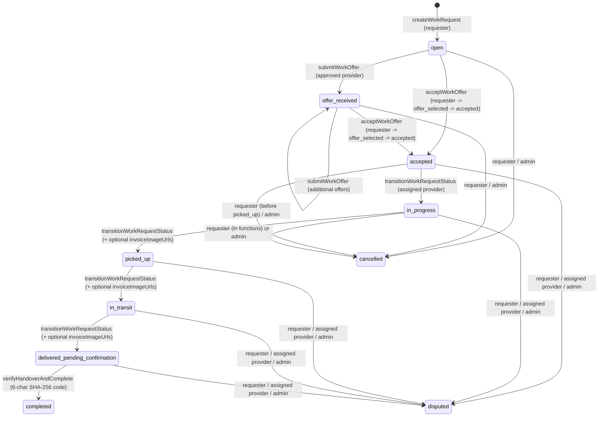

# API Specifications & Cloud Functions v2 Architecture — MASHWAR Platform
## Qatar Worksite Supply MVP Server Authority, State Machine & Callable Contracts

### 1. Hybrid Backend Communication Model
When `USE_FIREBASE=true`, MASHWAR combines two complementary access patterns against Firebase project `mashwar-qatar-2026-ec99d` (`europe-west1`):

1. **Direct Cloud Firestore Queries & Reads:** Used for reading open `work_requests`, requester-owned `work_request_handover_view/{requestId}`, participant `request_events`, `provider_profiles`, `business_profiles`, and owner `notifications`, all guarded by [`firestore.rules`](../../firestore.rules).
2. **Firebase Cloud Functions v2 HTTPS Callables (`functions/`):** All multi-document mutations, offer selections, state-machine transitions, salted SHA-256 handover verifications, mutual ratings, payment settlement verifications, and admin reviews execute inside transactional Node.js 20 Cloud Functions ([`functions/src/index.ts`](../../functions/src/index.ts), [`functions/src/handlers.ts`](../../functions/src/handlers.ts)).

#### Client Transport (`FirebaseFunctionsCallableClient`)
[`lib/data/services/firebase_firestore_service.dart`](../../lib/data/services/firebase_firestore_service.dart) invokes v2 `onCall` functions over HTTPS `POST` with `Authorization: Bearer <FirebaseAuth ID Token>` and JSON body `{"data": <payload>}`:
- **Production URL:** `https://europe-west1-mashwar-qatar-2026-ec99d.cloudfunctions.net/<functionName>`
- **Emulator Override:** `--dart-define=FUNCTIONS_EMULATOR_HOST=127.0.0.1:5001` -> `http://127.0.0.1:5001/mashwar-qatar-2026-ec99d/europe-west1/<functionName>`
- **Custom Base Override:** `--dart-define=FUNCTIONS_BASE_URL=...`
- **Typed Error Mapping:** Maps `HttpsError` / `DomainError` codes (`unauthenticated`, `permission-denied`, `invalid-argument`, `not-found`, `failed-precondition`, `already-exists`, `unavailable`) into bilingual `WorksiteRepositoryException` instances.

---

### 2. Worksite Supply Request State Machine

Implemented identically in [`functions/src/stateMachine.ts`](../../functions/src/stateMachine.ts) and [`lib/data/models/worksite_models.dart`](../../lib/data/models/worksite_models.dart) (`WorkRequestStatusMachine`):



#### Non-Negotiable Transition Rules
- **No Requester Self-Completion:** `delivered_pending_confirmation -> completed` is **rejected** in `transitionWorkRequestStatus`; only `verifyHandoverAndComplete` can mark a request `completed` after validating the requester's handover secret.
- **Approved Provider Gate & No Self-Bidding:** Only users with `provider_profiles/{uid}.approvalStatus == 'approved'` and `uid != request.requesterId` can submit offers or advance fulfillment stages.
- **Terminal Immutability:** `completed` and `cancelled` are terminal states.

---

### 3. Implemented Callable Cloud Functions (`functions/src/index.ts`)

All 9 callables run in `europe-west1` on Node.js 20 and execute atomic Firestore transactions:

#### 1. `createWorkRequest`
- **Caller:** Any authenticated user (`uid != null`).
- **Input:**
  ```json
  {
    "title": "50x PVC Conduit Pipes 20mm + Junction Boxes",
    "description": "Urgent electrical rough-in supplies, Qatar standard",
    "pickupLocation": "Industrial Area Street 15 Electrical Wholesale",
    "deliveryLocation": "Lusail Marina Tower Gate 3",
    "deliveryArea": "لوسيل",
    "budgetMinor": 45000,
    "paymentMethod": "cash_on_delivery",
    "referenceImageUrls": []
  }
  ```
- **Validation & Side Effects:** Requires integer `budgetMinor > 0` (`100` minor units = `1 QAR`), `paymentMethod` in `['cash_on_delivery', 'bank_transfer_manual']`, rejects forged `paymentStatus != 'unpaid'`, creates `work_requests/req_<uuid>` in `status: 'open'`, and appends `request_events/evt_<uuid>` (`request_created`).

#### 2. `submitWorkOffer`
- **Caller:** Authenticated approved provider (`provider_profiles/{uid}.approvalStatus == 'approved'`, `uid != requesterId`).
- **Input:** `{ "requestId": "req_...", "totalAmountMinor": 43000, "serviceFeeMinor": 6000, "etaMinutes": 60, "notes": "In stock near Street 15" }`
- **Validation & Side Effects:** Verifies request is `open` or `offer_received`; creates `work_offers/off_<uuid>` (`status: 'pending'`), increments `offerCount`, transitions request to `offer_received`, writes `request_events` (`offer_submitted`) and requester `notifications` (`new_offer`).

#### 3. `acceptWorkOffer`
- **Caller:** Authenticated request owner (`request.requesterId == uid`).
- **Input:** `{ "requestId": "req_...", "offerId": "off_..." }`
- **Validation & Side Effects:**
  - Confirms offer is `pending` for `requestId` and provider remains `approved`.
  - Sets `selectedOfferId`, `assignedProviderId`, `agreedAmountMinor`, `agreedFeeMinor`, and transitions `status` (`offer_selected` -> `accepted`); marks chosen offer `accepted` and all other pending offers `rejected`.
  - Mints a 6-character code from `ABCDEFGHJKLMNPQRSTUVWXYZ23456789` via `crypto.randomBytes`, generates a 128-bit hex salt, writes `{ codeHash, codeSalt, expiresAtUtc (+24h), attemptsRemaining: 5, maxAttempts: 5, usedAtUtc: null }` to `work_request_secrets/{requestId}`, and writes `{ requesterId, handoverCode, expiresAtUtc }` to `work_request_handover_view/{requestId}`.
  - Appends `offer_selected` + `offer_accepted` events and notifies the assigned provider.

#### 4. `transitionWorkRequestStatus`
- **Caller:** Assigned approved provider, requester (pre-pickup cancel / dispute), or active admin.
- **Input:** `{ "requestId": "req_...", "targetStatus": "picked_up", "invoiceImageUrls": ["https://..."], "reason": null }`
- **Validation & Side Effects:** Enforces `assertWorkRequestTransition`; permits attaching up to 10 `invoiceImageUrls` on `picked_up`, `in_transit`, or `delivered_pending_confirmation`; blocks any attempt to pass `paymentStatus` or set `completed`; records `request_events` and counterparty `notifications`.

#### 5. `verifyHandoverAndComplete`
- **Caller:** Assigned approved provider (`request.assignedProviderId == uid`).
- **Input:** `{ "requestId": "req_...", "code": "K7M4P9" }`
- **Validation & Side Effects:**
  - Requires `request.status == 'delivered_pending_confirmation'`, `secret.usedAtUtc == null`, `secret.attemptsRemaining > 0`, and `now <= secret.expiresAtUtc`.
  - Performs constant-time `crypto.timingSafeEqual` against `SHA-256(codeSalt + ':' + code.trim().toUpperCase())`.
  - **On mismatch:** Persists `attemptsRemaining - 1` + `handover_attempt_failed` event, then throws `failed-precondition` with `{ attemptsRemaining }`.
  - **On match:** Sets `secret.usedAtUtc`, marks request `status: 'completed'` + `completedAtUtc`, increments `provider_profiles/{uid}.completedTasksCount`, logs `handover_completed` event, and notifies requester.

#### 6. `submitRequestRating`
- **Caller:** Request participant (`requesterId` or `assignedProviderId`) after `status == 'completed'`.
- **Input:** `{ "requestId": "req_...", "stars": 5, "comment": "Accurate invoice and on-time Lusail delivery" }`
- **Validation & Side Effects:** Writes deterministic `ratings/${requestId}_${uid}` (rejecting duplicates with `already-exists`) and updates target `provider_profiles` or `business_profiles` running `ratingAvg` and `ratingCount`.

#### 7. `recordPaymentStatus`
- **Caller:** Requester (submitting manual transfer proof), participant (flagging dispute), or active admin (marking settled).
- **Input:** `{ "requestId": "req_...", "targetPaymentStatus": "transfer_proof_submitted", "paymentProofUrl": "https://..." }`
- **Validation & Side Effects:** Enforces `unpaid -> transfer_proof_submitted` (requester, requires `paymentMethod == 'bank_transfer_manual'` and valid `paymentProofUrl`), `* -> verified_settled` (active admin only, writes `admin_audit_logs`), and **strict immutability** once `paymentStatus == 'verified_settled'`.

#### 8. `adminReviewProvider`
- **Caller:** Authenticated staff member with active `admin_staff/{uid}` (`isActive == true` and `role` in `superAdmin`, `reviewAdmin`, `compliance`, `operations`).
- **Input:** `{ "providerId": "uid_...", "decision": "approved", "reason": null }` (mandatory `reason` when `rejected` or `suspended`).
- **Validation & Side Effects:** Updates `provider_profiles/{providerId}` and `provider_verifications/{providerId}`, appends immutable `admin_audit_logs/aud_<uuid>`, and notifies provider.

#### 9. `adminModerateWorkRequest`
- **Caller:** Active `admin_staff/{uid}` (`superAdmin`, `reviewAdmin`, `supportAdmin`, `compliance`, `operations`).
- **Input:** `{ "requestId": "req_...", "action": "resolve_dispute", "targetStatus": "delivered_pending_confirmation", "reason": "Verified store invoice and site gate log" }`
- **Supported Actions:** `cancel`, `flag_dispute`, `resolve_dispute` (`targetStatus` in `cancelled` \| `in_progress` \| `delivered_pending_confirmation`), and `verify_payment_settled`. Writes both `request_events` and `admin_audit_logs`.

---

### 4. Deferred External Payment Webhooks
Online PSP webhooks (e.g., QPay, SkipCash, Fawran, card acquiring) and automated wallet/escrow ledger credits are **intentionally not active** in Phase 1 (`AppEnvironment.enableDigitalWallet = false`, `AppEnvironment.enableEscrowClaims = false`) pending Qatar Central Bank (QCB) regulatory compliance and licensed PSP contracting.
